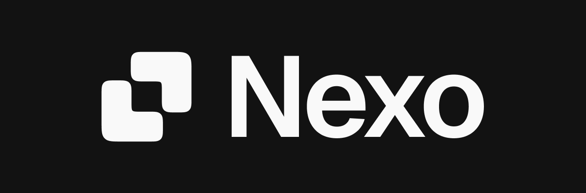
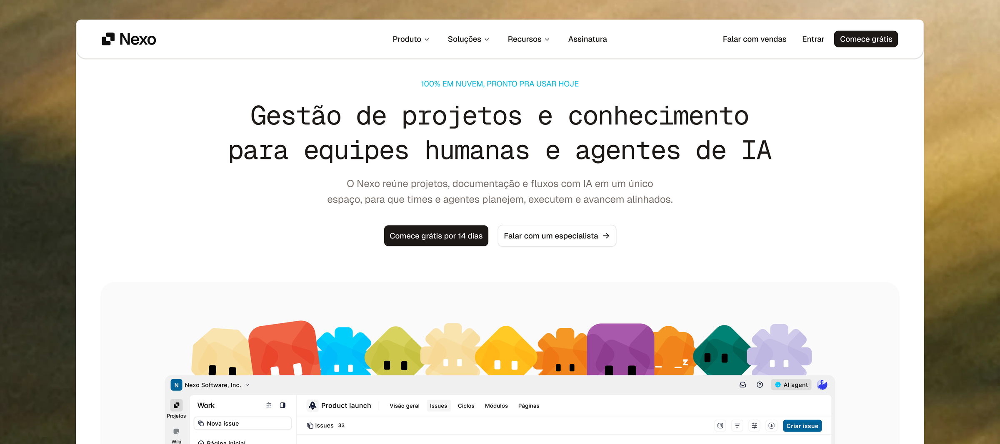

<p align="center">
  <a href="README.md">Português</a> · <b>English</b>
</p>

<br />

<p align="center">
    <a href="https://nexopm.com" target="_blank" align="center">
      
    </a>
</p>
<p align="center"><b>Project management that actually works for your team</b></p>

<p align="center">
    <a href="https://nexopm.com/"><b>Website</b></a> •
    <a href="https://nexopm.com/status"><b>Status</b></a> •
    <a href="https://www.instagram.com/nexopmapp"><b>Instagram</b></a> •
    <a href="https://www.linkedin.com/company/nexoso"><b>LinkedIn</b></a> •
    <a href="https://nexopm.com/docs"><b>Documentation</b></a>
</p>

<p align="center">
  <a href="https://nexopm.com" target="_blank">
    
  </a>
</p>

<p align="center">
  <a href="https://github.com/castrogusttavo/nexo/actions/workflows/ci.yml">
    
  </a>

  <a href="https://github.com/castrogusttavo/nexo/actions/workflows/cd.yml">
    
  </a>

  <a href="https://www.react.doctor/share?p=nexo&s=84&e=1&w=62&f=31">
    
  </a>

  <a href="https://codecov.io/gh/castrogusttavo/nexo">
    
  </a>

  <a href="LICENSE">
    
  </a>

  <a href="CONTRIBUTING.md">
    
  </a>
</p>

Meet [Nexo](https://nexopm.com/), a project management platform built for teams that want to ship without fighting their tools. Multi-tenant by default, opinionated where it matters, and ready to grow with you.

> Nexo is in active development. Projects, issues, the collaborative wiki, billing and the status page are live; embedded AI, dashboards and integrations are next. Suggestions, ideas, and reported bugs help us immensely.

## Installation

Two ways to run Nexo:

- **Nexo Cloud.** Sign up at [nexopm.com](https://nexopm.com) — the fastest path to get started, with no infrastructure to manage.
- **Self-host with Docker.** Bring your own infrastructure. The full stack runs from a single Compose file — see [`infra/app.yml`](./infra/app.yml) to get started.

| Installation method | Documentation                                    |
| ------------------- | ------------------------------------------------ |
| Docker              | [`infra/app.yml`](./infra/app.yml)               |

## Features

- **Projects and issues.** States, priorities, labels, assignees, start and due dates, sub-issues, dependencies, relations, comments, attachments and votes.
- **Four layouts.** List, board (kanban), calendar and timeline, with the same filters across all of them.
- **Filters and PQL.** A visual filter builder or PQL, a text query language: `priority IN (HIGH, URGENT) isOverdue() order-by due-date`.
- **Estimates.** Three systems (points, categories and time) and six models, such as Fibonacci and T-shirt sizes. Each project picks its own, and the values are editable.
- **Cycles and modules.** Each issue can be linked to a cycle (time box) and a module (subject).
- **Collaborative wiki.** Real-time multiplayer editing, diagrams as code (Mermaid, PlantUML and Graphviz), an Excalidraw whiteboard, equations, comments, and import and export in Markdown, HTML, Word, PDF and image.
- **Sticky notes.** Personal notes with checklists and six colors, visible only to their author.
- **Workspaces.** Multi-tenant from day one. Slug-based URLs, role-based access (`OWNER`, `ADMIN`, `MEMBER`, `VIEWER`), invitations and isolated data per team.
- **Authentication.** Email and password, Google and GitHub OAuth, email verification, password reset, and two-factor auth through an authenticator app or an emailed code, with backup codes.
- **Billing.** Plans (`FREE`, `PRO`, `BUSINESS`, `ENTERPRISE`) with AbacatePay integration, a 14-day trial and a webhook-driven subscription lifecycle.
- **Status page.** Public `/status` with proactive probes across eight components (app, database, cache, auth, payment, email, storage and background jobs), incident timelines, post-mortems, 90-day history and Slack alerts.
- **Privacy (LGPD).** Cookie consent, data export, and real account deletion after 30 days, with the team's content kept anonymously.
- **Transactional email.** React Email templates for welcome, verification codes, password reset, account deletion, data export, invites, trial and incident post-mortems.
- **API documentation.** OpenAPI reference rendered with Scalar at `/docs`.

## Roadmap

What comes next:

- **Embedded AI:** a chat that sees the team's projects and wiki, with no context pasted by hand.
- **Dashboards and analytics:** real-time insights across projects.
- **Full cycles:** creating and managing cycles and modules, an active cycles screen and burn-down charts.
- **Integrations:** GitHub, Slack and other everyday tools.
- **Search and shortcuts:** a command bar (Ctrl+K) and keyboard shortcuts.
- **Inbox:** workspace notifications and updates in one place.

## Stack

- **Backend** — Next.js 16 (App Router), PostgreSQL, Prisma 7, Redis, BullMQ, Silo (S3), Better Auth, Resend.
- **Frontend** — React 19, Tailwind CSS 4, Base UI, TanStack Query, React Email, Hugeicons.
- **Quality** — Vitest, Playwright, Stryker, Biome, Commitlint, Husky.
- **Observability** — Axiom (logs, audit trail, web vitals), Sentry (error tracking), PostHog (product analytics, consent-gated).

## Screenshots

<!--
  Drop product screenshots in the slots below — one per feature or flow.
  Suggested folder: ./public/brand/screens/<name>.png
-->

<p>
    <a href="https://nexopm.com" target="_blank">
      <!--  -->
    </a>
</p>

<p>
    <a href="https://nexopm.com" target="_blank">
      <!--  -->
    </a>
</p>

<p>
    <a href="https://nexopm.com" target="_blank">
      <!--  -->
    </a>
</p>

<p>
    <a href="https://nexopm.com" target="_blank">
      <!--  -->
    </a>
</p>

<p>
    <a href="https://nexopm.com" target="_blank">
      <!--  -->
    </a>
</p>

## Local development

Spin up the infrastructure (Postgres, Redis, BullMQ worker, Silo for S3 storage) with Docker Compose, then run the dev server:

```bash
pnpm install
pnpm docker:create        # first run only — creates and starts containers
pnpm prisma:migrate:dev   # apply migrations
pnpm dev
```

For subsequent runs, `pnpm infra` starts the containers and applies pending migrations in one step. The compose files live in `infra/`: `dev.yml` (this stack), `app.yml` (the application containers), `prod.yml` (the server's infrastructure) and `loadtest.yml`. See them and the `scripts` block in `package.json` for the full picture.

## Documentation

API reference and product documentation live at [nexopm.com/docs](https://nexopm.com/docs).

## Contributing

Contributions are welcome — see [`CONTRIBUTING.md`](CONTRIBUTING.md) for setup instructions, coding conventions, and the PR process. By participating, you agree to follow our [Code of Conduct](CODE_OF_CONDUCT.md).

## Security

If you discover a security vulnerability, please report it responsibly instead of opening a public issue. See [`SECURITY.md`](SECURITY.md) for how to report one privately — email **security@nexopm.com** with a description and reproduction steps. We take all legitimate reports seriously and investigate them promptly.

## License

Nexo is licensed under the [GNU Affero General Public License v3.0](LICENSE) (AGPLv3).
