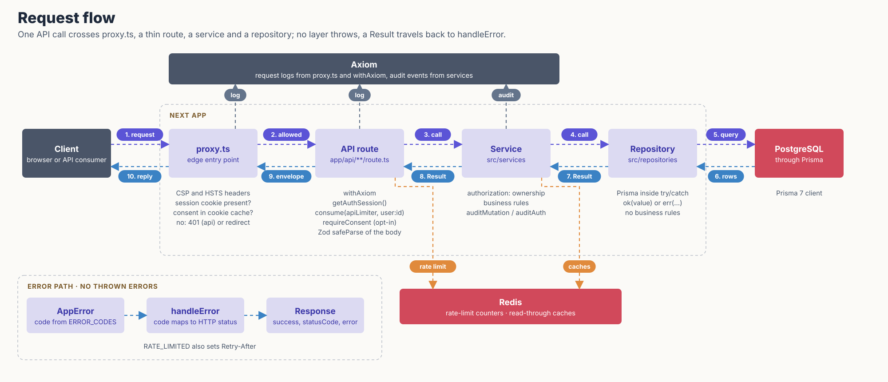

# HTTP API

## Purpose

How the Nexo HTTP API behaves as a whole: the response envelope, authentication, rate limits, the error model, pagination, and how `public/openapi.json` is kept honest. Per-endpoint detail is in [endpoints.md](./endpoints.md) and every error code in [error-codes.md](./error-codes.md).



## Envelope

Every product endpoint answers with one shape, typed in `types/http-response.d.ts` and produced by `utils/http-response.ts`:

```json
{ "success": true, "statusCode": 200, "data": {}, "message": "optional" }
{ "success": false, "statusCode": 422, "error": { "code": "VALIDATION_ERROR", "details": [] }, "message": "optional" }
```

`successResponse(data, status, message?, cacheOptions?)` can also set `Cache-Control`. Errors go through `handleError(AppError)`, which looks the status up in `ERROR_CODES`. `message` is pt-BR product copy; clients branch on `error.code`.

Documented exceptions, which answer to a caller outside the product:

- `/api/auth/**`: Better Auth payloads, outside the envelope (stated in the `info.description` of the spec).
- `POST /api/payment/webhook`: answers `{ received }` or `{ error }`, flat 500 on failure so the provider retries.
- `GET /api/health`: `{ status: 'ok' }` with 200, or `{ status: 'unavailable' }` with 503; used as the container health check and the `app` status probe.

## Authentication

- Session cookie `better-auth.session_token` (or the `__Secure-` variant), issued by Better Auth; declared as the `cookieAuth` scheme in the spec. See [auth](../architecture/auth.md).
- `proxy.ts` rejects `/api/*` requests without the cookie with `401 UNAUTHORIZED`, except paths in `PUBLIC_ROUTES` (for the API: `/api/auth`, `/api/status`, `/api/payment/webhook`, `/api/talk-to-sales`, `/api/careers`, `/api/health`). That check is optimistic; each route resolves the session with `getAuthSession()` and the services enforce roles and ownership.
- Two shared-secret schemes exist for machines: `x-webhook-secret` (AbacatePay webhook, env `ABACATE_PAY_WEBHOOK_SECRET`) and `x-status-secret` (status collector, env `STATUS_COLLECTOR_SECRET`, constant-time comparison).
- Platform admin routes (`/api/admin/**`) additionally require an admin; admins must have two-factor on (`ADMIN_TWO_FACTOR_REQUIRED`).
- There are no API keys or bearer tokens for third parties in the code. A public API program is not defined in this repository.

## Rate limits

`src/lib/rate-limit.ts` defines Redis-backed limiters (`rate-limiter-flexible`):

| Limiter | Budget | Used for |
| --- | --- | --- |
| `apiLimiter` | 100 per 60 s | authenticated routes, keyed `user:<id>`; the status snapshot, keyed by IP |
| `authLimiter` | 10 per 15 min, 30 min block | `/api/auth/*`, keyed `<ip>:<path>` |
| `otpLimiter` | 5 per 15 min | OTP paths under `/api/auth/*` |
| `emailLimiter` | 5 per hour | outgoing mail per recipient (`src/lib/mail/send.ts`) |
| `uploadLimiter` | 10 per 60 s | avatar, cover, workspace logo |
| `exportLimiter` | 1 per 24 h | personal data export |

A rejection is `429 RATE_LIMITED` with `Retry-After`. If Redis itself fails, `consume` logs `rate_limit_store_error` and lets the request through (fail open), except the auth limiters, which have an in-memory insurance limiter. Better Auth's own limiter counts in Redis (`betterAuthRateLimitStorage`) and is on only in production. The client IP comes from the rightmost untrusted `X-Forwarded-For` hop (`src/lib/rate-limit-helpers.ts`, `TRUSTED_PROXIES`); see [postmortem 2026-10-15](../postmortems/2026-10-15-better-auth-shared-bucket.md). nginx adds its own `limit_req` zones in front ([infrastructure](../architecture/infrastructure.md)).

## Pagination

There is no single convention; the code has three, all opt-in per endpoint:

- **Page and pageSize**: `GET /workspaces/{id}/members` (`page` default 1, `pageSize` default 20, max 100). The response carries `members`, `total`, `page`, `pageSize`; sorting and slicing happen in the service (`member.service.ts`).
- **Cursor on a string**: `GET .../projects/{slug}/updates` (`cursor`, `limit` default 20, max 50); the response carries `nextCursor` (null at the end).
- **Cursor on an issue number**: `GET .../projects/{slug}/issues` (`cursor`, `limit` up to 1000; `ListIssuesQuerySchema`); not described in the spec.
- Everything else returns the full list.

## Validation

Bodies are parsed with Zod (`src/schemas/*.schema.ts`); a failure is `422 VALIDATION_ERROR` with the issues in `error.details`. `withValidatedBody` in `utils/api-handler.ts` treats an unparsable JSON body as `{}`, so it also ends as a validation error.

## OpenAPI and the contract suite

`public/openapi.json` is **hand-maintained** (OpenAPI document "Nexo API", version 1.0.0, servers `http://localhost:3000/api` and `https://nexopm.com/api`). Nothing generates it. `pnpm test:contract` (project `contract`, files in `src/__tests__/contract/`) rebuilds the truth from the code and fails when the spec drifts:

- `openapi-routes.contract.test.ts`: every exported method in `app/api/**/route.ts` must be documented and every documented operation must exist (Better Auth paths excluded; they have their own check).
- `openapi-spec.contract.test.ts`: refs resolve, bodies use the envelope (except the two listed exceptions), documented error codes exist in `ERROR_CODES` at the documented status, `security` is declared exactly where `PUBLIC_ROUTES` in `proxy.ts` demands a session, and path parameters match the template.
- `openapi-request-bodies.contract.test.ts`: documented request bodies are compared field by field against the Zod schemas through an explicit map that fails when a documented body has no match.
- `dockerignore.contract.test.ts`: not about the API; checks the image build context keeps what the server needs (see [postmortem 2026-09-20](../postmortems/2026-09-20-csp-and-missing-proxy.md)).

A new endpoint is therefore not done until the spec documents it. CI runs the suite as the `contract-tests` job and the CI gate requires it.

## Scalar reference

The interactive reference is `app/(private)/reference/route.ts` using `@scalar/nextjs-api-reference` on `/openapi.json`. It answers only when `NODE_ENV === 'development'`; in every other environment it returns 404, and `proxy.ts` lets `/reference` and `/openapi.json` through without a session only in development. `public/openapi.json` itself is a static file. `/docs` (`app/(web)/docs/page.tsx`) is currently a placeholder page, not the API reference. This differs from `CLAUDE.md`, which says Scalar is rendered at `/docs`.

## Gotchas

- The spec's summaries are pt-BR; code names and error codes are English.
- Error `message` strings are pt-BR and not stable; codes are.
- Path parameter `{id}` for workspaces is the id, while pages use the slug.
- The spec's `servers` list a production URL; a deployed production does not serve the Scalar page.

## Related files

- `utils/http-response.ts`, `utils/api-handler.ts`, `types/http-response.d.ts`
- `src/errors/codes.ts`, `src/lib/rate-limit.ts`, `src/lib/rate-limit-helpers.ts`
- `proxy.ts`, `public/openapi.json`, `app/(private)/reference/route.ts`
- `src/__tests__/contract/*.contract.test.ts`
