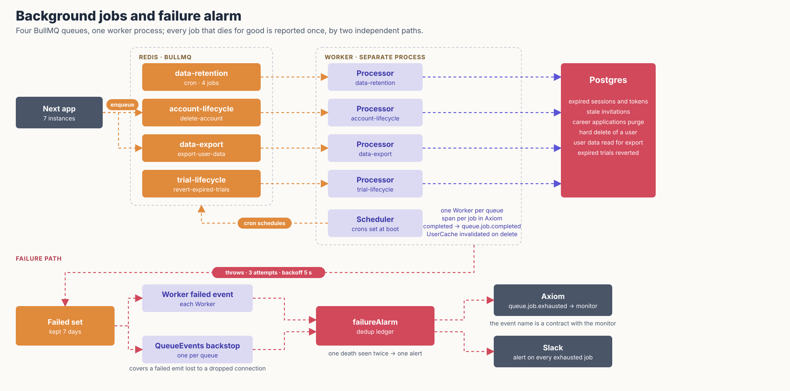

# Background jobs

## Purpose

Work that must not run inside a web request runs in a separate Node process, the **worker**, fed by BullMQ queues stored in Redis: scheduled cleanups, delayed account deletion, user data exports and trial expiry. This page describes the queues, how jobs are scheduled and retried, and the **failure alarm contract** that makes sure a job that dies for good is never silent.

## How it works

### Queues and jobs

Queue names and the typed job names/payloads live in `src/lib/queue/jobs.ts`. There are four queues, each with one processor:

| Queue | Jobs | Processor | What it does |
| --- | --- | --- | --- |
| `data-retention` | `cleanup-expired-sessions`, `cleanup-expired-verification-tokens`, `expire-stale-invitations`, `purge-expired-career-applications` | `src/lib/queue/processors/data-retention.ts` | Deletes sessions 30 days after expiry, verification tokens 1 day after expiry, marks pending invitations `EXPIRED`, purges career applications (and their stored resume) after 365 days. Windows are in `src/lib/queue/retention.ts`. |
| `account-lifecycle` | `delete-account` | `src/lib/queue/processors/account-lifecycle.ts` | Hard-deletes a user after the grace period, then invalidates `UserCache`. Skips (does not fail) if the user is gone or the deletion was canceled. |
| `data-export` | `export-user-data` | `src/lib/queue/processors/data-export.ts` | Gathers a user's data, writes it to the `user-exports` bucket, e-mails a presigned link valid for 7 days. |
| `trial-lifecycle` | `revert-expired-trials` | `src/lib/queue/processors/trial-lifecycle.ts` | Reverts workspaces whose trial expired, then invalidates each `WorkspaceCache` entry. |

### Producers: the Next app

The web app only enqueues. Queue singletons are lazy and share one set of default options in `src/lib/queue/queues.ts`: 3 attempts, exponential backoff starting at 5 s, completed jobs kept for 24 h (max 1000), failed jobs kept for 7 days. Enqueue helpers:

- `enqueueUserExport(userId)` in `src/lib/queue/data-export.ts`.
- `scheduleAccountDeletion(userId, scheduledAt)` / `cancelAccountDeletion(userId)` in `src/lib/queue/account-lifecycle.ts`. The grace period is 30 days (`ACCOUNT_DELETION_GRACE_DAYS`); `ACCOUNT_DELETION_GRACE_OVERRIDE_MS` shortens it outside tests.

### Scheduling: crons at boot

`worker/index.ts` calls `scheduleDataRetentionJobs()` and `scheduleTrialLifecycleJobs()` (`src/lib/queue/scheduler.ts`) on every boot. They use BullMQ `upsertJobScheduler`, so a restart or several boots never duplicate a schedule.

- `data-retention`: `0 3 * * *` UTC, all four jobs (`src/lib/queue/retention.ts`).
- `trial-lifecycle`: `0 * * * *` UTC, hourly (`TRIAL_EXPIRY_CRON` in `src/config/trial.ts`).

### The worker process

`worker/index.ts` registers one BullMQ `Worker` per queue, all sharing one Redis connection from `src/lib/queue/connection.ts` (`maxRetriesPerRequest: null`; TLS when `REDIS_TLS_ENABLED`, optionally verified against the CA at `REDIS_TLS_CA_PATH`). Each processor is wrapped in `createJobTracing(...).wrap(...)` (`lib/otel/job-tracing.ts`): one span per job shipped to the Axiom traces dataset, a no-op without `AXIOM_TRACES_TOKEN`. Completed jobs log `queue.job.completed` with the duration.

In production the worker is the `nexo-worker` service in `infra/app.yml`, running `node dist/worker.cjs` from the same image as the app. The bundle is built by `pnpm worker:build` (esbuild), invoked from the `Dockerfile`. See [infrastructure.md](./infrastructure.md).

On `SIGTERM`/`SIGINT`, `closeWorkerResources` (`src/lib/queue/worker-shutdown.ts`) closes in dependency order: workers, failure listener, pending Slack alerts, queues, Redis connection, logger flush. Order matters: a job failing on its way out is still reported.

## The failure alarm contract

Why it exists: `delete-account` once threw a foreign-key violation on every run, exhausted its retries and sat in the failed set with nobody told. A queue that always fails looks like a queue that never runs, unless the final failure is loud (comment in `src/lib/queue/failure-alarm.ts`).

**One event per death.** When BullMQ gives up on a job (moves it to `failed`), exactly one `queue.job.exhausted` log line is written at error level. A failure that will still be retried never emits it; it emits `queue.job.failed` (informational, with `willRetry`). A stall that BullMQ requeues emits only a `queue.job.stalled` warning.

**Reasons** (`JobExhaustedReason`): `attempts_exhausted`, `unrecoverable` (BullMQ `UnrecoverableError`, skips remaining attempts) and `stalled` (job exceeded `maxStalledCount`; BullMQ fails it on its next pickup with the message `job stalled more than allowable limit`, which is why that string is matched in code).

**Stable contract.** An Axiom monitor alerts on the event name `queue.job.exhausted` and reads the fields of `JobExhaustedFields` (`queue`, `jobName`, `jobId`, `attemptsMade`, `maxAttempts`, `reason`, `message`, `stack`, `payload`). Renaming the event or a field silently disables the alarm. If you must change it, change the monitor in the same commit. The monitor itself is not in this repository (TODO: confirm where it is defined).

**Two independent reporters, one alert.** `createJobFailureAlarm()` is created once in `worker/index.ts` and shared:

1. The Worker `failed` event (`alarm.workerFailed`) classifies the failure with `exhaustionReason`.
2. A `QueueEvents` backstop (`src/lib/queue/failure-listener.ts`), one per queue, reports every job that reaches the failed set from any process or code path. It covers a Worker `failed` emit lost to a dropped Redis connection after the Lua script already moved the job. It reads the job back to recover name, payload ids and attempts, and listens from `$`, so a restart does not replay old failures.

**Dedup.** Both reporters call the same alarm. An in-memory `DeathLedger` keyed by `queue:jobId` and valued by `finishedOn` lets only the first report through, so a death seen twice alarms once. A job retried by hand that dies again has a new `finishedOn` and counts as a new death. Capacity is 1000 entries (oldest dropped).

**Slack.** Each new death also posts to Slack through `sendSlackAlert` (`src/lib/alerts/slack.ts`), only when `SLACK_ALERTS_WEBHOOK_URL` is set (unset is a logged no-op). Sends are bounded by a 3 s timeout, never throw, and log `alerts.slack.failed` without the URL. The message contains queue/job names, attempt counters, the allowlisted payload ids and a sanitized error message (`sanitizeAlertText` strips e-mails, URL credentials and bearer tokens and escapes Slack markup). Never the full payload or the stack.

## Key decisions and why

- **Separate process, same image.** Jobs must survive web deploys and not compete with request handling. One image keeps the code and env validation identical.
- **Redis for queues, schedulers at boot.** No external cron: schedules are data in Redis, upserted idempotently.
- **Allowlisted payload ids.** Only `userId` and `workspaceId` reach logs (`PAYLOAD_IDENTIFIER_KEYS`). A new payload key never leaks by default (LGPD).
- **A cache failure must not fail a job.** `revert-expired-trials` logs cache invalidation errors instead of throwing, because a retry would re-run the repository and report different counts for the same work.
- **A `/status` probe watches the worker.** The `jobs` component checks every queue has a connected worker and that the waiting backlog is at most 25. See [status-page.md](./status-page.md).

## Gotchas

- BullMQ rejects `:` in custom job ids; `delete-account-<userId>` is used (`deleteAccountJobId`).
- A custom `jobId` makes BullMQ drop a second `add()`. `scheduleAccountDeletion` therefore removes any pending job first so rescheduling moves the deadline. `queue.remove` answers success for a missing job and `0` for a locked one, so existence is read separately.
- The dedup ledger is in memory and per process. With a single worker this is enough; a second worker process would not share it (TODO: confirm the worker always runs as a single container; `infra/app.yml` defines one).
- The worker imports `server-only` modules through `worker/server-only.shim.ts`, since it runs outside Next.
- Failed jobs are removed after 7 days, so the failed set is not a permanent record. The Axiom log line and the Slack message are.

## Related files

- `worker/index.ts`, `worker/server-only.shim.ts`
- `src/lib/queue/jobs.ts`, `queues.ts`, `scheduler.ts`, `retention.ts`, `connection.ts`, `worker-shutdown.ts`
- `src/lib/queue/failure-alarm.ts`, `src/lib/queue/failure-listener.ts`
- `src/lib/queue/processors/*.ts` and their tests in `src/lib/queue/processors/__tests__/`
- `src/lib/alerts/slack.ts`
- `lib/otel/job-tracing.ts`, `lib/axiom/logger.ts`
- `src/services/status/probes.ts` (`probeJobs`)
- `infra/app.yml` (`nexo-worker`)
