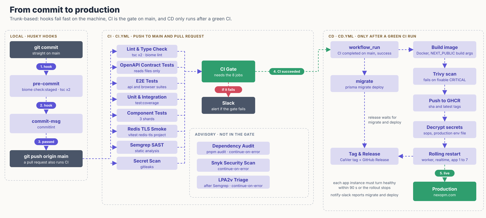

# Infrastructure

## Purpose

How Nexo is built into an image, deployed and run in production, and what each part of the stack is. Statements marked **(operator-provided)** come from the project owner and are not verifiable from the repository. Anything else cites the file that shows it. Where the repo is silent, the text says "not defined in this repository".

## Overview

Production (operator-provided): several Next instances run behind nginx on one host; Cloudflare fronts `nexopm.com` (DNS and proxy), and nginx restores the client IP from Cloudflare's ranges; object storage is a self-hosted S3-compatible service named Silo; `ci.yml` runs on push to `main` and `cd.yml` deploys after a successful CI run. See [ADR 0001](../adr/0001-trunk-based-development.md) and [ADR 0007](../adr/0007-silo-storage.md).

## The image

`Dockerfile` has two stages on `node:24-alpine`:

- **builder**: installs dependencies with pnpm (`--frozen-lockfile`; the HugeIcons registry token is a BuildKit secret), then runs `pnpm prisma:generate`, `pnpm build`, `pnpm worker:build` and `pnpm realtime:build`. `NEXT_PUBLIC_*` values arrive as build args and are baked into the client bundle (they are public by design). `NEXT_DEPLOYMENT_ID` and `NEXT_PUBLIC_SENTRY_RELEASE` are the commit SHA, for version-skew protection and release tracking. `DATABASE_URL`, `REDIS_URL` and `SKIP_ENV_VALIDATION` are dummy values so the build can import routes without services.
- **runner**: non-root user, `npm`, `npx` and `corepack` removed (the image only runs `node`), `libcrypto3`/`libssl3` upgraded, copies `.next/standalone`, `.next/static`, `public` and `dist`. Default command `node server.js` on port 3000.

`next.config.ts` sets `output: 'standalone'`, which is what production runs and why the browser tests boot the standalone artifact ([ADR 0006](../adr/0006-standalone-output-and-browser-tests.md)). The same image also holds `dist/worker.cjs` and `dist/realtime.cjs`, so one build ships three processes.

## Production stack

Two compose files in `infra/`, both copied to `/var/www/nexo` on the server (relative paths resolve there, which is why `infra/dev.yml` uses `../` and these do not):

**`infra/app.yml`** (application, copied as `docker-compose.yml`):

- `nexo-app-1` ... `nexo-app-7`: seven identical instances of `ghcr.io/castrogusttavo/nexo:latest`, each published on loopback `127.0.0.1:3001-3007`, `mem_limit: 1500m`, `NODE_OPTIONS=--max-semi-space-size=64`, healthcheck on `/api/health`. The file explains the sizing: one Node process saturates a core at about 45 req/s on a 12 vCPU, 12 GB host, and capping the V8 heap raised CPU per request, so the memory ceiling is at container level instead.
- `nexo-worker`: `node dist/worker.cjs` ([background-jobs.md](./background-jobs.md)).
- `nexo-realtime`: `node dist/realtime.cjs`, on loopback `127.0.0.1:1234`; nginx proxies `/realtime` to it (comment in `app.yml`).
- Containers resolve `nexopm.com` and `storage.nexopm.com` to `host-gateway`, because the router does not hairpin; nginx terminates TLS there. Never use the LAN address (the host changed address once and self-calls broke for 17 days).
- Public, non-secret env (`NEXT_PUBLIC_URL`, `BETTER_AUTH_URL`, `NEXT_PUBLIC_REALTIME_URL`) is set in the file; everything else comes from `.env`.

**`infra/prod.yml`** (stateful services, copied as `docker-compose.infra.yml`): Postgres 17 (`nexo-db-1`), Redis with TLS (`nexo-redis`), a streaming read replica (`nexo-db-replica`), PgBouncer in transaction mode bound to loopback `127.0.0.1:6432`, and Silo (`nexo-minio-1`, image `pgsty/silo`). Container names are kept deliberately: the nightly backup calls `docker exec nexo-db-1 pg_dump`. The file records that RabbitMQ was removed because nothing speaks AMQP; queues are BullMQ over Redis. Whether the app currently points at the replica or PgBouncer is not declared in the compose files: `infra/app.yml` takes `DATABASE_URL_POOLED` and `DATABASE_URL_REPLICA` from the host `.env` (decrypted from sops, not in the repository). What the code does with them: `src/lib/prisma.ts` uses `DATABASE_URL_POOLED ?? DATABASE_URL`, and `getPrismaReplica()` (`src/lib/prisma-replica.ts`) falls back to the primary when `DATABASE_URL_REPLICA` is unset; its only caller is `src/repositories/issue.repository.ts` (issue reads). `infra/loadtest.yml` sets all three.

The infra file is **copied but not applied** by CD: recreating Postgres or Redis is a human decision, done through the `server-ops` workflow.

## nginx (host install)

Production nginx is installed on the host; the repo keeps the source of truth for its drop-ins in `infra/nginx/` (copied from the server on 2026-10-18, install by hand):

- `nexo-upstream.conf`: `upstream nexo_app`, `least_conn` over `127.0.0.1:3001-3007`, `max_fails=3 fail_timeout=10s`, so an instance being replaced leaves the rotation.
- `nexo-ratelimit.conf`: `limit_req` zones (30 r/s global, 20 r/s API, 60 r/m auth, 10 r/m upload), a load-test bypass keyed on a secret header (placeholder only in the repo), and the `X-Forwarded-For` mapping that keeps the first entry for load tests.
- `nexo-gzip.conf`: compression for proxied responses; the app runs with `compress: false` because gzip in Node cost more CPU than serving a prerendered page.
- `cloudflare-realip.conf`: `real_ip_header CF-Connecting-IP` honoured only from Cloudflare's published ranges, so `$remote_addr`, `X-Real-IP` and the `X-Forwarded-For` hop the app reads see the visitor. A direct hit to the origin cannot spoof the header.
- `nginx.conf` is only for the local load-test stack (`infra/loadtest.yml`).

The server blocks, certificates and `/realtime` location are not defined in this repository.

## CI/CD

`.github/workflows/ci.yml` runs on push to `main` and on pull requests. Jobs include lint and type check, OpenAPI contract tests, e2e (matrix), unit and integration with coverage, component tests (3 shards), audit, Snyk, Semgrep, LPA2v triage, Redis TLS smoke, gitleaks and PR-title check. The `gate` job requires lint, contract, e2e, coverage, component, semgrep, gitleaks and redis-tls-smoke. Pushes that touch only root `*.md` or `LICENSE` skip it.

`.github/workflows/cd.yml` triggers on `workflow_run` of `CI` for `main` and proceeds only if the conclusion is `success`. Concurrency group `cd-production`, never cancelled. Jobs, on the self-hosted runner (which is the server):

1. **migrate**: `pnpm prisma:deploy` with the migration database URL secret.
2. **deploy**: builds the image for scanning, runs **Trivy** (blocks on CRITICAL, unfixed ignored), pushes to GHCR tagged by SHA and `latest`, decrypts `secrets/production.enc.env` with sops into `/var/www/nexo/.env`, appends `SLACK_ALERTS_WEBHOOK_URL` from the CI secret when sops does not define it, copies the two compose files, pulls, restarts worker and realtime, then replaces app instances **one at a time**, waiting up to 90 s for each to be healthy and aborting the rollout otherwise. nginx always has six serving.
3. **release**: creates a CalVer tag `YYYY.MM.DD[.N]` and a GitHub Release at the deployed SHA.
4. **notify-slack**: posts the result.

Other workflows: `server-ops.yml` (manual `workflow_dispatch` with specific modes: `compose-diff`, `backup-inspect`, `backup-run`, `infra-apply`, `app-up`, `replication-prepare`, `replication-status`, `db-pool-status`, `load-snapshot`, `host-bench`, `nginx-upstream`, `env-sync`, among others), `load-production.yml` (manual k6 breakpoint/hold), `performance.yml` and `security-dast.yml` (weekly), `mutation.yml` (weekly Stryker), `react-doctor.yml`.

## Environments and secrets

- **Local**: `pnpm dev` starts `infra/dev.yml` (Postgres with a replica, Redis, Silo storage and PgBouncer). `infra/loadtest.yml` is a separate nginx-balanced stack for local load tests plus `next dev`; `pnpm infra` starts the containers only.
- **Production secrets**: sops-encrypted in `secrets/production.enc.env`; names are validated by `lib/env/`. Do not paste decrypted values anywhere.
- **Observability**: Axiom (logs, traces), Sentry (errors, source maps uploaded in the CD build only), PostHog through a same-origin `/ingest` rewrite, and the public status page ([status-page.md](./status-page.md)).

## Key decisions and why

- **One image, three processes** (web, worker, realtime): one build, identical env validation.
- **Many small instances** rather than one large: Node is single-threaded; capacity is measured in the comments of `infra/app.yml` and `next.config.ts`.
- **Rolling deploy gated on health**, because a bad image must stop at the first instance.
- **Infra changes are explicit.** Stateful services never restart as a side effect of an app deploy.
- **Trunk-based, CI as the safety net**: a red CI never reaches production ([ADR 0001](../adr/0001-trunk-based-development.md)).

## Gotchas

- Names such as `nexo-db-1` and `nexo-minio-1` are load-bearing (backup, storage tooling). Do not rename.
- Migrations run before the new image is up; keep them backward compatible with the instances still serving.
- `nexo-minio-1` still carries the MinIO name; the server is Silo because MinIO withdrew its public images ([ADR 0007](../adr/0007-silo-storage.md)).
- nginx config changes in `infra/nginx/` do nothing until installed on the host; nginx refuses to change an existing zone's key on reload (hence the `_lt` zone names).
- Server layout beyond `/var/www/nexo` (backup script, cron, certificates) is not defined in this repository. `server-ops.yml` modes `backup-inspect` and `backup-run` read and run the backup script on the host, but the script itself is not versioned.

## Related files

- `Dockerfile`, `.dockerignore`
- `infra/app.yml`, `infra/prod.yml`, `infra/dev.yml`, `infra/loadtest.yml`, `infra/docker/`
- `infra/nginx/*.conf`
- `.github/workflows/ci.yml`, `cd.yml`, `server-ops.yml`, `load-production.yml`
- `next.config.ts`, `.sops.yaml`, `secrets/production.enc.env` (encrypted; never decrypt into docs)
