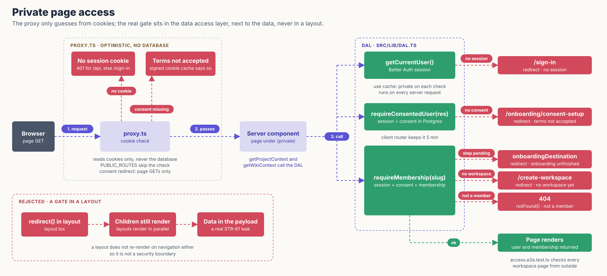

# Multi-tenancy

Nexo serves many workspaces from one deployment and one database. This document explains how a tenant is identified, how a user is tied to it, and where isolation is actually enforced. The short version: tenancy is a convention enforced in application code, not a database feature.



## The tenant is a workspace

The `Workspace` model (`prisma/schema.prisma`) has a unique `slug`, a plan, settings switches and a timezone. A user belongs to a workspace through `Membership`, a row with `userId`, `workspaceId` and a `role` (`Role`: `OWNER`, `ADMIN`, `MEMBER`, `VIEWER`). `@@unique([userId, workspaceId])` allows one membership per pair, so a user can belong to several workspaces but holds one role in each. Deleting a user or a workspace cascades to its memberships.

Workspace-owned data hangs off the workspace: `Project`, `ProjectState`, `ProjectLabel`, `WorkspaceInvitation`, `WikiPage`, `Subscription`. Everything below a project (issues, cycles, modules, comments) reaches the workspace through `projectId`. A few models are user-scoped instead of workspace-scoped; `StickyNote` has only a `userId`.

## The tenant in the URL

Workspace-scoped pages live under `app/(private)/[workspace-slug]` (`(home)`, `ai`, `projects`, `settings`, `wiki`). The slug is the only tenant selector in the URL; the id is resolved server-side.

## Resolving the tenant for a page

Pages call `requireMembership(slug)` from `src/lib/dal.ts`. It reads the user from the session, checks consent, and looks the membership up with `MembershipService.getByUserAndSlug(userId, slug)`. The repository query is keyed by the user and the slug together:

```ts
prisma.membership.findFirst({
  where: { userId, workspace: { slug } },
  include: { workspace: true },
})
```

So a slug that exists but where the caller has no membership yields no row, exactly like a slug that does not exist. When there is no membership the DAL routes the visitor: to onboarding if their `onboardingStep` is not null, to `/create-workspace` if they have no memberships at all, otherwise `notFound()`.

On success it returns the user and a `MembershipDTO` that carries the workspace, which downstream helpers use: `getProjectContext` (`src/lib/project-context.ts`) takes `membership.workspaceId`, `membership.role` and workspace switches from it.

## Resolving the tenant for an API call

API routes receive ids, not slugs. The service must prove the caller belongs to the workspace before touching its data:

- `assertMember(actorId, workspaceId)` (`src/services/_authz.ts`) looks the membership up with the `userId_workspaceId` unique key and returns `forbidden()` when absent.
- `assertPrivileged` additionally requires `OWNER` or `ADMIN` (`PRIVILEGED_ROLES`).
- `resolveProject` (`src/services/_project-scope.ts`) runs `assertMember` in parallel with a project lookup scoped by `workspaceId`, then `projectAccess` applies the project-level rule.

Project visibility is a second layer inside the workspace. In `src/repositories/project.repository.ts` a non-privileged member's project list is filtered to projects that are public, led by them, or where they are a `ProjectMember`.

## Where isolation is enforced

- **Application code only.** There is no Postgres row-level security in the schema; every repository query that returns tenant data must carry the workspace (or user) in its `where`, and every service must call an `_authz` helper first. A forgotten check is a cross-tenant leak, which is why `app/(private)/__tests__/access.e2e.test.ts` exists: it requests every workspace page as an anonymous user, a stranger and an unconsented member, and fails if an id leaks into the HTML.
- **Caches are keyed by id, after the check.** `WorkspaceService.getById` calls `assertMember` before reading `WorkspaceCache`, so the cache never bypasses authorization (see [caching.md](./caching.md)).

## Invitations and roles

New members arrive through `WorkspaceInvitation` (its own `role` defaulting to `MEMBER`, with an `InviteStatus`). Accepting an invitation creates the `Membership` inside a transaction in `src/repositories/invitation.repository.ts`; creating a workspace creates the owner's membership in `src/repositories/workspace.repository.ts`. The error registry has dedicated codes for the failure modes (`INVITATION_NOT_FOUND`, `INVITATION_EXPIRED`, `INVITATION_EMAIL_MISMATCH`, `INVITATION_ALREADY_MEMBER`, `SEAT_LIMIT_REACHED`), all in `src/errors/codes.ts`.

Roles gate capabilities inside the workspace. `isPrivilegedRole` (`OWNER` or `ADMIN`) is the one predicate services use for "may manage", and some switches on `Workspace` change what plain members may do, for example `membersCanCreateProjects`. Plan limits (`Plan`, `Subscription.seats`) also live on the workspace.

## Caches and tenants

Redis keys for tenant data embed the tenant or the entity id (`workspace:v5:<workspaceId>`, `issues:list:page:<projectId>:...`). The key never contains authorization; it only identifies data. That is why the membership check must precede any cache read.

## Key decisions

- **Slug in the URL, id in the API.** Slugs are human-friendly and stable per workspace; ids are what services and foreign keys use.
- **Same answer for "missing" and "not yours".** The membership lookup cannot distinguish them, which avoids confirming that a workspace exists.
- **Gate where data is read.** The authorization lives in the DAL rather than in the workspace layout. See [ADR 0003](../adr/0003-dal-instead-of-layout-gates.md) and [auth.md](./auth.md).

## What a new tenant-scoped feature must do

1. Put `workspaceId` (or a parent that carries it) on the model, and include it in repository `where` clauses.
2. Call `assertMember` or `assertPrivileged` in the service before reading or writing.
3. Add any new private page to `app/(private)/__tests__/access.e2e.test.ts`.
4. For API routes, document the endpoint in `public/openapi.json`; the contract suite fails until it is.

## Gotchas

- `getWorkspaceMembership` in `src/lib/workspace-context.ts` is a plain `react` `cache` wrapper around the same service call; it does not redirect or check consent, so it is not a replacement for `requireMembership` on a page.
- A new private page must be added to `app/(private)/__tests__/access.e2e.test.ts`.
- Roles are per workspace. `isPrivileged` in project context means workspace `OWNER` or `ADMIN`, not a platform admin (platform admin access is a separate concept, see `src/lib/admin-access.ts`; I did not trace it for this document).
- Authorization failures from services surface as `FORBIDDEN` (403); a page treats a missing membership as a 404 or a redirect instead.

## Related files

- `prisma/schema.prisma` (`Workspace`, `Membership`, `Role`)
- `src/lib/dal.ts`, `src/lib/project-context.ts`, `src/lib/workspace-context.ts`
- `src/services/_authz.ts`, `src/services/_project-scope.ts`, `src/services/membership.service.ts`
- `src/repositories/membership.repository.ts`, `src/repositories/project.repository.ts`
- `app/(private)/__tests__/access.e2e.test.ts`
