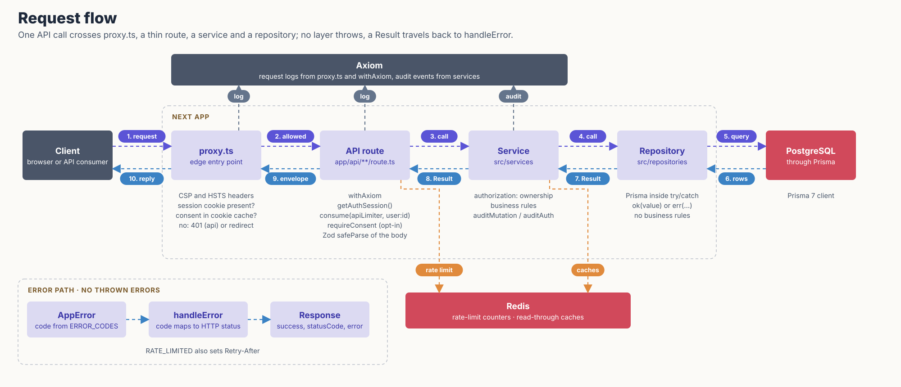

# Request flow

This document follows an HTTP request from the edge entry to the database and back, and explains the conventions that keep the layers uniform: the `Result` type, the error registry and the response envelope.



## Edge: `proxy.ts`

In Next.js 16 `middleware.ts` was renamed Proxy; Nexo's entry is `proxy.ts` at the repository root (see `node_modules/next/dist/docs/01-app/01-getting-started/16-proxy.md`). For every request not excluded by its `matcher` (static files, images and fonts are skipped) it:

1. Logs the request to Axiom.
2. Checks the path against `PUBLIC_ROUTES`. Public routes get security headers and pass.
3. Otherwise looks for the `better-auth.session_token` cookie (or its `__Secure-` variant). Without it, `/api/*` gets a `401` JSON body and pages are redirected to `/sign-in?redirect=...`.
4. For page GETs (not `/api`, not `/onboarding`, not a server action) reads Better Auth's signed cookie cache; if it positively says the terms were not accepted, redirects to `/onboarding/consent-setup`.
5. Sets `Content-Security-Policy` and `Strict-Transport-Security`.

Both checks are optimistic: they look at a cookie, never at the database. Real authorization happens later. See [auth.md](./auth.md).

## API route handlers

A typical authenticated route is a few lines because `utils/api-handler.ts` wraps the shared sequence. `app/api/sticky-notes/route.ts`:

```ts
export const GET = withAuthenticatedRoute(({ userId }) =>
  StickyNoteService.list(userId),
)

export const POST = withValidatedBody(
  CreateStickyNoteSchema,
  ({ userId, data }) => StickyNoteService.create(userId, data),
  { successStatus: 201, consentResource: 'page:(private)' },
)
```

`withAuthenticatedRoute` does, in order:

1. Wraps the handler in `withAxiom` for logging.
2. `getAuthSession()`; on failure returns `handleError(...)`.
3. Consumes `apiLimiter` with the key `user:<id>` (`src/lib/rate-limit.ts`).
4. If `consentResource` is set, calls `requireConsent` (`src/lib/consent.ts`).
5. Runs the handler, which returns a `Result`; maps `ok` to `successResponse` and an error to `handleError`.

`withValidatedBody` adds step zero: parse the JSON body (a malformed body becomes `{}`), `safeParse` it with the Zod schema, and return `validationError('Dados inválidos', issues)` on failure.

Not every route uses these wrappers (for example the `app/api/users/me/**` routes, `app/api/invitations/accept` and `app/api/health` do not import them); those compose the same pieces by hand or need none.

## Services and repositories

Services own business rules and authorization (for example `assertMember` / `assertPrivileged` in `src/services/_authz.ts`) and emit audit events. Repositories wrap Prisma calls in try/catch and return `Result` values, mapping failures to `databaseError(...)` or `notFound(...)`. Mappers convert Prisma models to DTOs before they leave the service.

## The Result type

`src/lib/result.ts` is the whole implementation:

```ts
export type Result<T, E = AppError> =
  | { ok: true; value: T }
  | { ok: false; error: E }
```

with `ok(value)` and `err(error)` constructors. Callers narrow with `if (!result.ok) return result`, which propagates the error unchanged up to the route. See [ADR 0002](../adr/0002-result-instead-of-throw.md).

## Errors

`AppError` (`src/errors/app-error.ts`) is a plain object `{ code, message, details? }`. `ERROR_CODES` (`src/errors/codes.ts`) is the single registry mapping each code to an HTTP status (for example `VALIDATION_ERROR` is 422, `RESOURCE_NOT_FOUND` 404, `RATE_LIMITED` 429). Construct errors with the factory helpers (`unauthorized()`, `forbidden()`, `notFound('X')`, `validationError()`, `rateLimited()`), and add new codes to `codes.ts` first.

## Response envelope

`utils/http-response.ts` produces every response:

- `successResponse(data, status = 200, message?, cacheOptions?)` gives `{ success: true, statusCode, data }`.
- `errorResponse` / `standardError` / `handleError` give `{ success: false, statusCode, error: { code, details? }, message? }`.
- `handleError(error)` looks the status up in `ERROR_CODES` and, for `RATE_LIMITED`, sets `Retry-After` from `details.retryAfterSeconds`.

The shapes are typed in `types/http-response`, and `public/openapi.json` is checked against them by the contract tests.

## Rate limiting

`src/lib/rate-limit.ts` defines Redis-backed limiters (auth, otp, email, api, export, upload) with `rate-limiter-flexible`. `consume(limiter, key)` returns a `Result`. If Redis itself fails, it logs `rate_limit_store_error` and returns `ok`, so a Redis outage does not take the API down (it fails open). The `apiLimiter` budget is 100 points per 60 seconds.

## Gotchas

- `CLAUDE.md` describes the route sequence in explicit steps; the sticky-notes route actually delegates to `withAuthenticatedRoute` / `withValidatedBody`, which implement those steps.
- User-facing error messages in services are in Portuguese; codes and logs are English.
- Pages do not go through this path. They use the DAL; see [auth.md](./auth.md).

## Related files

- `proxy.ts`, `utils/api-handler.ts`, `utils/http-response.ts`
- `src/lib/result.ts`, `src/errors/app-error.ts`, `src/errors/codes.ts`
- `src/lib/auth-session.ts`, `src/lib/rate-limit.ts`, `src/lib/consent.ts`
- `app/api/sticky-notes/route.ts`
