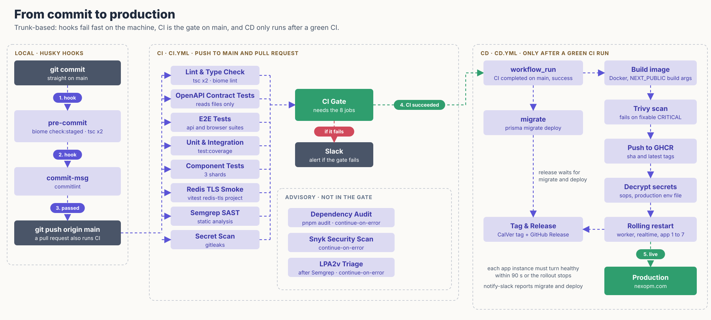

# Conventions

The rules the code follows and the tooling that enforces them. Where a rule is enforced by a tool, the config file is named.

## Language

Code, comments, commit messages and developer docs are English. User-facing product strings (UI copy, transactional emails, legal and marketing pages) are Portuguese (pt-BR). Tests query the pt-BR strings. Marketing copy avoids the em dash; this is a copy rule, not a code rule.

## Path alias and the two `lib` folders

`@/*` maps to the repository root (`tsconfig.json`, `paths`), so imports look like `@/src/services/...`, `@/lib/...`, `@/components/...`. Vitest mirrors it in `vite.config.ts`.

There are two `lib` directories: root `lib/` (axiom, env, abacatepay, legal, posthog) and `src/lib/` (auth, prisma, redis, queue, rate-limit, result, storage, mail). Root `lib/` and `utils/` are not in Biome's `files.includes` (see below).

## Component files and folders

- **File names:** kebab-case file, and the exported component is its exact PascalCase (`user-sticky-list.tsx` exports `UserStickyList`).
- **Domain prefix:** in `app/_components/<domain>/` the file starts with the domain and does not repeat subfolders (`app/_components/user/sticky/user-sticky-list.tsx`). Route-local files start with the route's subject.
- **Kind goes last:** `-dialog`, `-form`, `-list`, `-card`, `-button`, `-picker`, `-tab`, `-field`, `-menu`, `-panel`, `-view`, `-provider`, `-skeleton`. New files say `dialog`, never `modal`. Generic names (`columns.tsx`, `banner.tsx`) are not allowed.
- **Folders:** `components/` is generic and never imports from `app/` (`components/ui` holds shadcn primitives). `app/_components/` nests by domain ownership (for example `workspace/project/issue/`, with feature subfolders such as `filter` and `layout`), never by kind.
- Exceptions: brand casing (`posthog-tracker.tsx` exports `PostHogTracker`), the barrel kit `navigation/sidebar-context/`, and the existing `user/modal/`.

Source: `CLAUDE.md` (which cites a vault page, `Resources/conventions.md`, that is outside this repository; its content is not defined in this repository, so this page is checked against the code instead).

## Route colocation

A route folder holds only Next files (`page`, `layout`, `loading`, `error`, `route`) and private folders prefixed with `_`, which the router ignores:

- `_components/` UI, `_hooks/`, `_actions/` server actions, `_lib/` helpers, constants, types.
- Component tests sit next to what they test, in `_components/__tests__/`; tests of the route files (`page`, `layout`, e2e) stay in `<route>/__tests__/`.
- A folder that only groups routes may own a `_components/` shared by its children. Code shared by sibling routes goes in the nearest common parent (for example `app/onboarding/_actions`).
- File names do not change when a file moves into a private folder.

Example: `app/(private)/[workspace-slug]/settings/_components/`.

## Rendering rules (Cache Components)

Pages render a heading synchronously and read `params`, the session or data in an async component under `<Suspense>`. Server components that read user or workspace data call the data access layer (`src/lib/dal.ts`) first. Details: [caching](../architecture/caching.md), [auth](../architecture/auth.md), [ADR 0003](../adr/0003-dal-instead-of-layout-gates.md), [ADR 0004](../adr/0004-no-use-cache-for-runtime-data.md). Opt out of instant navigation with `export const instant = false` and a comment only where blocking is the point.

## Biome

Config: `biome.json`. Run `pnpm check` (fix) or `pnpm check:ci` (no writes; what CI effectively verifies; CI's `lint` job runs `pnpm biome lint --error-on-warnings`, then `tsc`).

- Formatter has two blocks on purpose: top-level `indentStyle: tab`, but `javascript.formatter` sets 2 spaces, single quotes, `semicolons: asNeeded`, trailing commas `all`, line width 80, and `jsxQuoteStyle: single`. CSS uses double quotes.
- `noParameterAssign`, `useAsConstAssertion`, `useDefaultParameterLast`, `useSelfClosingElements`, `noUselessElse` and several other `style` rules are errors; `noUnusedImports` is a warning that auto-fixes.
- Several rules are off (`noExplicitAny`, `noForEach`, several `a11y` rules).
- **Scope:** `files.includes` covers `app/`, `src/`, `worker/`, `e2e/` and `playwright.config.ts`. Root `lib/`, `components/`, `utils/` and `realtime/` are not listed. Known behaviour: `CLAUDE.md` states this same scope (its Biome convention says `lib/`, `components/` and `utils/` are not linted), so the exclusion is documented, not accidental; the repository does not record why.
- `pnpm lint`, `pnpm format` (also `prisma format`), `pnpm format:check`, `pnpm check:staged` exist.

## Commits and hooks

Conventional Commits, enforced by commitlint (`commitlint.config.js`): types `feat`, `fix`, `docs`, `style`, `refactor`, `perf`, `test`, `build`, `ci`, `chore`, `revert`; lower-case type, non-empty subject, no trailing full stop, header at most 100 characters. Commit small and thematic.

Husky hooks (`.husky/`):

| Hook | Runs |
| --- | --- |
| `pre-commit` | `pnpm check:staged` (Biome `--fix --staged`), then `git update-index --again` to re-stage the fixed files, then `pnpm tsc --noEmit` and `pnpm tsc --noEmit -p e2e` |
| `commit-msg` | `pnpm exec commitlint --edit $1` |

Because the hook re-stages whole files, a partial `git add -p` selection does not survive it. Work is committed straight to `main`; never force-push `main`. Pull requests are for external contributors (`CONTRIBUTING.md`), and CI's `pr-title` job requires a conventional-commit title.

## Other rules

- Env vars: import the typed export, never `process.env` ([getting-started](./getting-started.md)).
- Prisma models use `@map` and `@@map` for snake_case database names while the code stays camelCase.
- Errors: construct with the factories in `src/errors/app-error.ts`; add new codes to `src/errors/codes.ts` first.

## Related files

- `biome.json`, `tsconfig.json`, `commitlint.config.js`, `.husky/pre-commit`, `.husky/commit-msg`
- `CONTRIBUTING.md`, `CLAUDE.md`
- [Feature workflow](./feature-workflow.md)
