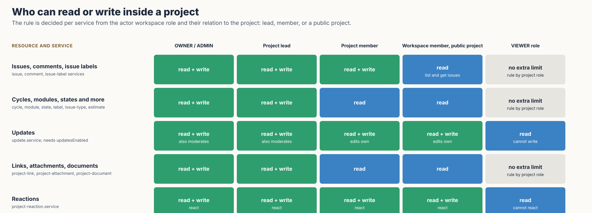

# Cycles

A cycle is a time-boxed batch of work inside a project (a sprint). Issues point to a cycle through `Issue.cycleId`; the cycle itself carries a status, optional dates, a lead and a member list. The backend is complete; the project UI for managing cycles is not built yet (see Routes and UI). Modules, the topic-based sibling, are in [module.md](./module.md). Issues are in [issue.md](./issue.md).

## Contract

`src/schemas/cycle.schema.ts`:

- `CycleStatusSchema`: `NOT_STARTED | IN_PROGRESS | COMPLETED`.
- `CreateCycleSchema`: `name` 2 to 100 chars, optional `description` (max 500), `status` default `NOT_STARTED`, optional `startDate` and `endDate` (ISO datetimes).
- `UpdateCycleSchema`: every field optional; dates are nullable so they can be cleared.
- `src/schemas/cycle-member.schema.ts`: `AddCycleMemberSchema` is `{ userId }` (cuid2).

DTOs (`CycleDTO`, `CycleMemberDTO` in `types/cycle`) are built by `src/mappers/cycle.mapper.ts`. A member DTO carries `isLead`, computed against the cycle's `leadId`.

## Data model

`prisma/schema.prisma`:

- `Cycle`: `name`, `description?`, `status` (`CycleStatus`), `startDate?`, `endDate?`, `leadId?` (`SetNull` when the user is deleted), `projectId` (cascade). Indexed on `(projectId, status)` and `leadId`.
- `CycleMember`: `(userId, cycleId)` unique, cascade from both sides.
- `Issue.cycleId` is `SetNull`, so deleting a cycle detaches its issues instead of deleting them.

*Who can read or write each project-scoped resource.*

## Service rules and authorization

`src/services/cycle.service.ts`. Each method resolves the project with `resolveProject` first.

- **Read** (`list`, `listMembers`): public project, OWNER/ADMIN, lead or project member; otherwise `PROJECT_FORBIDDEN`.
- **Write** (`create`, `update`, `delete`, `addMember`, `removeMember`): OWNER/ADMIN or the project lead; otherwise `CYCLE_FORBIDDEN`. Project members who are not the lead cannot manage cycles.
- **One active cycle**: creating or updating a cycle to `IN_PROGRESS` fails with `CYCLE_ALREADY_ACTIVE` (409) when another cycle of the project is already `IN_PROGRESS` (`CycleRepository.findActiveByProject`). Updating the active cycle itself is fine. The check is a read before the write, not a database constraint, so two concurrent requests can both pass it.
- **Lead**: `create` sets `leadId` to the actor.
- **Ownership**: a cycle whose `projectId` differs from the resolved project answers `CYCLE_NOT_FOUND`, so ids from other projects or tenants reveal nothing.
- **Members**: `addMember` inserts a `CycleMember`; a duplicate (Prisma `P2002`) becomes `CYCLE_MEMBER_ALREADY_EXISTS`. The service does not check that the target user is a member of the project or workspace; only the database constraints apply (`CycleMember` foreign keys). Known behaviour: unlike project members (`PROJECT_MEMBER_NOT_IN_WORKSPACE`), any existing user id can be added to a cycle. `removeMember` refuses to remove the lead (`CYCLE_FORBIDDEN`, "Não é possível remover o lead do ciclo").
- **Activity**: `update` records changes to `status`, `startDate` and `endDate` through `recordFieldChanges` with entity type `CYCLE`; read them back via `GET .../activities?entityType=CYCLE&entityId=...` (see [activity-and-notifications.md](./activity-and-notifications.md)).
- **Audit**: `auditMutation` with `entity: 'cycle'` on create (also on failure), update, delete and member changes (`reason: 'member_added'` and similar).

There is no date-order validation (`endDate` before `startDate`) in the cycle service or schema, unlike projects (`project.schema.ts` refines `startDate <= dueDate`). Known behaviour: a cycle can be saved with `endDate` before `startDate`.

## Error codes

`CYCLE_NOT_FOUND` (404), `CYCLE_FORBIDDEN` (403), `CYCLE_ALREADY_ACTIVE` (409), `CYCLE_MEMBER_ALREADY_EXISTS` (409), `CYCLE_MEMBER_NOT_FOUND` (404), all in `src/errors/codes.ts`.

## Routes and UI

Under `app/api/workspaces/[id]/projects/[slug]/cycles/`:

| Route | Methods |
|---|---|
| `cycles` | GET, POST |
| `cycles/[cycleId]` | PATCH, DELETE (there is no single-cycle GET) |
| `cycles/[cycleId]/members` | GET, POST |
| `cycles/[cycleId]/members/[userId]` | DELETE |

UI state of play:

- Hooks exist in `src/hooks/use-cycle.ts` (`useCycles`, `useCreateCycle`, `useUpdateCycle`, `useDeleteCycle`, member hooks, `useCycle`).
- The only consumers are the issue-side pieces: `issue/picker/cycle-picker.tsx`, the list view and the issue filters (`app/_components/workspace/project/issue/`).
- The "Ciclos" project tab in `app/_components/workspace/project/project-tabs.tsx` is marked `comingSoon` and has no page; `app/(private)/[workspace-slug]/(home)/active-cycles/page.tsx` is a placeholder.
- `app/(private)/[workspace-slug]/projects/[slug]/settings/features/cycles/page.tsx` only toggles `Project.cyclesEnabled` (see [project.md](./project.md)).

## Caching

None. Cycles are read straight from Postgres; the client uses TanStack Query through the hooks.

## Gotchas

- `cyclesEnabled` is not enforced server-side: the cycle service does not read it, and the issue service accepts a `cycleId` regardless. It only hides the tab.
- `status` is manual. Nothing in the code moves a cycle from `NOT_STARTED` to `IN_PROGRESS` or `COMPLETED` by date; no job or service does it.
- Deleting a cycle is a hard delete and does not write an activity entry.

## Tests

- Unit: `src/services/__tests__/cycle.service.test.ts`, `src/mappers/__tests__/cycle.mapper.test.ts`, `src/schemas/__tests__/cycle*.schema.test.ts`.
- Integration: `src/repositories/__tests__/cycle.repository.test.ts`.
- E2E: `cycles/__tests__/route.e2e.test.ts`, `cycles/[cycleId]/__tests__/`, and the `members` folders under it.
- Factory: `src/__tests__/factories/cycle.factory.ts`.

## Related files

- `src/services/cycle.service.ts`, `src/repositories/cycle.repository.ts`, `src/mappers/cycle.mapper.ts`
- `src/hooks/use-cycle.ts`
- `app/api/workspaces/[id]/projects/[slug]/cycles/`
- `prisma/schema.prisma` (`Cycle`, `CycleMember`, `CycleStatus`)
