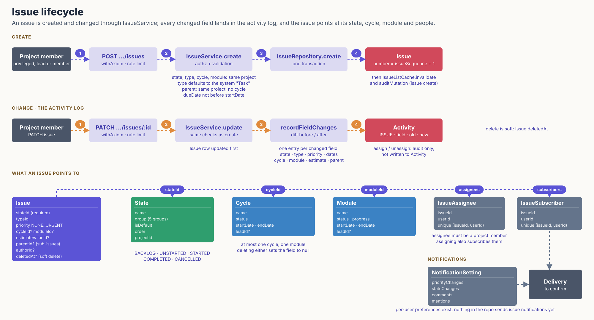
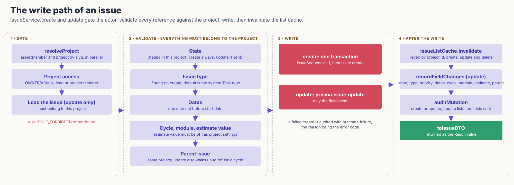

# Issues

An issue is the unit of work inside a project. This page covers the issue itself and the things that hang directly off it: assignees, subscribers, labels (the association, not the label catalogue), parent/child hierarchy, dependencies and relations. Comments, votes, attachments and the activity feed are in [activity-and-notifications.md](./activity-and-notifications.md). States, labels, issue types and estimates are in [label-state-estimate.md](./label-state-estimate.md). Cycles and modules have their own pages: [cycle.md](./cycle.md), [module.md](./module.md).

## Contract

Schemas live in `src/schemas/`:

- `issue.schema.ts`: `CreateIssueSchema` (`title` 1 to 255 chars, `description` as an array of rich-text blocks capped at 100,000 serialized chars, `stateId` required, `priority` default `NONE`, optional `startDate`, `dueDate`, `typeId`, `cycleId`, `moduleId`, `estimateValueId`, `parentId`). `UpdateIssueSchema` is the same shape, all optional, with the dates, `cycleId`, `moduleId`, `estimateValueId` and `parentId` nullable so a client can clear them. `ListIssuesQuerySchema` takes `cursor` and `limit` (max 1000).
- `issue-assignee.schema.ts` (`{ userId }`), `issue-label.schema.ts` (`{ labelId }`), `issue-dependency.schema.ts` (`{ targetId, type }`, type `BLOCKS | STARTS_BEFORE | FINISHES_BEFORE`), `issue-relation.schema.ts` (`{ targetId, type }`, type `RELATES_TO | IMPLEMENTS`).

IDs are validated with `z.cuid2()`. Dates are ISO datetimes (`IsoDate` in `src/schemas/_shared.ts`). The output type is `IssueDTO` in `types/issue`, built by `src/mappers/issue.mapper.ts` (`toIssueDTO`, plus assignee, dependency and relation mappers). Validation messages are pt-BR because they reach the user.

## Data model

Defined in `prisma/schema.prisma`:

- `Issue`: `number` is a per-project sequence, unique with `projectId`. `description` is `Json`. `deletedAt` makes delete a soft delete. `parentId` is a self relation (`IssueHierarchy`, `onDelete: SetNull`). `cycleId`, `moduleId`, `estimateValueId` are `SetNull` when the target is deleted; `stateId` and `typeId` have no `onDelete`, so they are restrictive. `authorId` is `SetNull` when the user is deleted.
- Join tables, all with a unique pair and cascade delete from the issue: `IssueAssignee`, `IssueSubscriber`, `IssueLabel`.
- `IssueDependency` and `IssueRelation`: `sourceId`, `targetId`, `type`, unique on `(sourceId, targetId, type)`.
- `Project.issueSequence` is the counter the number comes from.

The human identifier shown in the UI is `<project.identifier>-<number>` (for example `ABC-12`).

## Service rules and authorization

Everything is in `src/services/issue.service.ts` unless noted. Every method first calls `resolveProject` (`src/services/_project-scope.ts`), which checks workspace membership and loads the project with its members.

- **Read** (`list`, `getById`, `getByIdentifier`, `listChildren`, `count`): allowed when the project is public, or the actor is OWNER/ADMIN, the project lead, or a project member. Otherwise `PROJECT_FORBIDDEN`.
- **Write** (`create`, `update`, `delete`): the actor must be OWNER/ADMIN, the lead, or a project member, otherwise `ISSUE_FORBIDDEN`. A project member with workspace role `VIEWER` is not excluded by the service; the check is on project membership only. `TODO: confirm` whether that is intended.
- **Create**: the state must belong to the same project (`ISSUE_STATE_INVALID`), the type too (`ISSUE_TYPE_INVALID`). With no `typeId`, the system type named `Task` is used. `dueDate` before `startDate` is a `VALIDATION_ERROR`. A cycle, module or estimate value from another project answers as not found. A parent must live in the same project.
- **Numbering**: `IssueRepository.create` increments `Project.issueSequence` and creates the issue in one transaction, so concurrent creates do not collide.
- **Update**: same validations, plus a walk up the `parentId` chain to refuse loops (`ISSUE_PARENT_CYCLE`, 409). Changed fields are written to the activity feed through `recordFieldChanges` (`src/services/_activity-diff.ts`), fire-and-forget.
- **Delete**: sets `deletedAt`. Repository reads filter `deletedAt: null`.
- **Assignees** (`issue-assignee.service.ts`): the target must be a project member (`PROJECT_MEMBER_NOT_FOUND`). Assigning also subscribes the user to the issue. `subscribe` and `unsubscribe` live in the same service.
- **Labels** (`issue-label.service.ts`): the label must belong to the issue's project.
- **Dependencies** (`issue-dependency.service.ts`): both issues must be in the project; a breadth-first search over outgoing edges of the same type refuses cycles (`ISSUE_DEPENDENCY_CYCLE`).
- **Relations** (`issue-relation.service.ts`): an issue cannot relate to itself (`ISSUE_RELATION_SELF`, 422); duplicates give `ISSUE_RELATION_ALREADY_EXISTS`.

Audit: create, update, delete and each association change call `auditMutation` with `entity: 'issue'` (the association changes use `action: 'update'` with a `reason` such as `assign` or `add_dependency`).

## Error codes

From `src/errors/codes.ts`: `ISSUE_NOT_FOUND` (404), `ISSUE_FORBIDDEN` (403), `ISSUE_STATE_INVALID` (422), `ISSUE_TYPE_INVALID` (422), `ISSUE_ASSIGNEE_ALREADY_EXISTS` (409), `ISSUE_ASSIGNEE_NOT_FOUND` (404), `ISSUE_SUBSCRIBER_NOT_FOUND` (404), `ISSUE_LABEL_ALREADY_EXISTS` (409), `ISSUE_LABEL_NOT_FOUND` (404), `ISSUE_PARENT_CYCLE` (409), `ISSUE_DEPENDENCY_ALREADY_EXISTS` (409), `ISSUE_DEPENDENCY_NOT_FOUND` (404), `ISSUE_DEPENDENCY_CYCLE` (409), `ISSUE_RELATION_ALREADY_EXISTS` (409), `ISSUE_RELATION_NOT_FOUND` (404), `ISSUE_RELATION_SELF` (422). Project-level denial is `PROJECT_FORBIDDEN`.

## Routes and UI

All under `app/api/workspaces/[id]/projects/[slug]/issues/` (`[id]` is the workspace id):

| Route | Methods |
|---|---|
| `issues` | GET (optional `cursor`/`limit`), POST |
| `issues/[issueId]` | GET, PATCH, DELETE |
| `issues/by-identifier/[identifier]` | GET |
| `issues/[issueId]/children` | GET |
| `.../assignees`, `.../assignees/[userId]` | list/add, remove |
| `.../subscribe` | POST, DELETE |
| `.../labels`, `.../labels/[labelId]` | list/add, remove |
| `.../dependencies`, `.../dependencies/[dependencyId]` | list/add, remove |
| `.../relations`, `.../relations/[relationId]` | list/add, remove |

Each handler follows the standard chain (`withAxiom`, `getAuthSession`, `consume(apiLimiter, ...)`, Zod `safeParse`, service). Create routes also call `requireConsent`.

UI entry points:

- `app/(private)/[workspace-slug]/(home)/projects/[slug]/issues/page.tsx` renders the list, kanban, calendar and gantt views from `app/_components/workspace/project/issue/view/`, with `IssueCreateDialog` and filters (`issue/filter/`). It is `instant = true` and reads data through `getProjectContext`.
- `.../issues/[issueIdentifier]/page.tsx` currently renders only the breadcrumb with the issue crumb (resolved by `IssueService.getByIdentifier`). The detail UI is `issue-details-panel.tsx`, opened from the cards in the views.
- Pickers for state, type, priority, assignees, labels, cycle, module, parent, dates, dependencies and relations are in `issue/picker/`.
- Client state: `src/hooks/use-issue.ts`, `use-issue-assignee.ts`, `use-issue-label.ts`, `use-issue-dependency.ts`, `use-issue-relation.ts`.

*The write path of IssueService.create and update, from the gate to the cache invalidation.*

## Caching

`IssueListCache` (`src/cache/issue-list.cache.ts`) caches paginated lists only (a request with `limit`). Keys are `issues:list:page:<projectId>:<version>:<cursor>:<limit>` with a 30 second TTL and a per-project version key `issues:list:v:<projectId>`; invalidation increments the version, so old pages simply expire. Redis failures are logged and treated as a miss. Only `IssueService.create`, `update` and `delete` invalidate it. Unpaginated lists, `getById` and the association services do not use the cache.

## Gotchas

- Changing assignees or labels does not invalidate the list cache, and a cached page carries `labelIds` and `assigneeIds`, so a paginated list can show stale associations for up to 30 seconds. `TODO: confirm` whether the association services should call `IssueListCache.invalidate`.
- Activity is recorded only for the fields in `IssueService.update` (state, type, priority, dates, cycle, module, estimate, parent). Title, description, assignee and label changes are not in the feed.
- Cursor pagination is by `number` ascending, not by id.
- The `issueTypesEnabled`, `modulesEnabled`, `cyclesEnabled` and `estimatesEnabled` project switches are not checked in the issue service; see [project.md](./project.md).

## Tests

- Unit: `src/services/__tests__/issue*.service.test.ts`, mappers in `src/mappers/__tests__/issue.mapper.test.ts`, schemas in `src/schemas/__tests__/issue*.schema.test.ts`.
- Integration: `src/repositories/__tests__/issue*.repository.test.ts`, `src/cache/__tests__/issue-list.cache.test.ts` (Redis).
- E2E: `__tests__/route.e2e.test.ts` next to each route under `app/api/workspaces/[id]/projects/[slug]/issues/`.
- Component: pickers and views under `app/_components/workspace/project/issue/**/__tests__/`, hooks under `src/hooks/__tests__/`.
- Factory: `src/__tests__/factories/issue.factory.ts`.

## Related files

- `src/services/issue.service.ts`, `src/repositories/issue.repository.ts`, `src/mappers/issue.mapper.ts`
- `src/services/_project-scope.ts`, `src/services/_activity-diff.ts`
- `src/cache/issue-list.cache.ts`
- `app/api/workspaces/[id]/projects/[slug]/issues/`
- `prisma/schema.prisma` (`Issue`, `IssueAssignee`, `IssueSubscriber`, `IssueLabel`, `IssueDependency`, `IssueRelation`)
