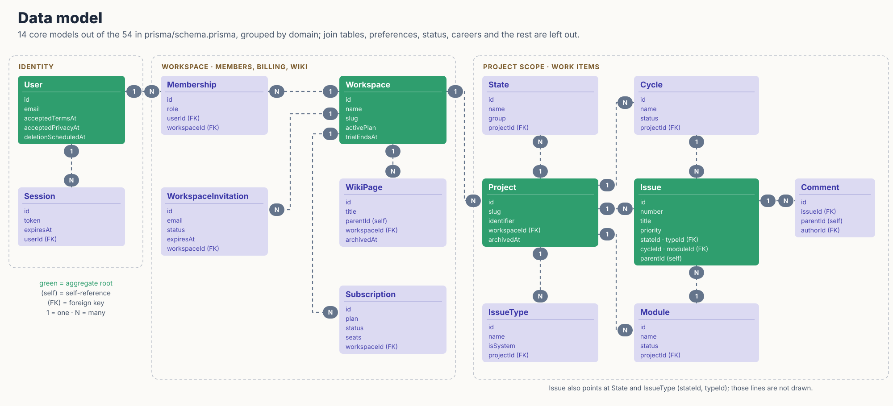
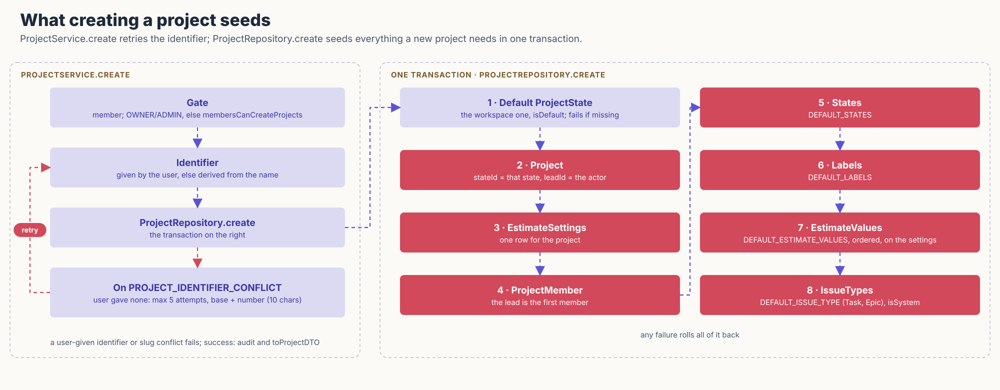

# Projects

A project is the container for issues inside a workspace. It owns its own states, labels, issue types, estimate settings, cycles, modules, members, links, attachments, a collaborative document and status updates. This page covers the project record, its lifecycle (create, edit, archive, restore, delete), members, favorites, reactions, links, attachments, progress and the feature switches. The per-project catalogues are in [label-state-estimate.md](./label-state-estimate.md); status updates are in [activity-and-notifications.md](./activity-and-notifications.md). Tenancy and membership are in [workspace-and-members.md](./workspace-and-members.md) and [../architecture/multi-tenancy.md](../architecture/multi-tenancy.md).

## Contract

`src/schemas/project.schema.ts`:

- `CreateProjectSchema`: `name` (2 to 100), `slug` (2 to 100, `^[a-z0-9-]+$`), optional `description` (max 500), `emoji`, `coverImage` (a path starting with `/` or a URL), `isPublic` (default false), the four feature booleans (default true) and an optional `identifier` (2 to 10 chars, `^[A-Z0-9]+$`).
- `UpdateProjectSchema`: all optional, plus `updatesEnabled`, `leadId`, `stateId` (a workspace project state), `labelIds` (max 20), `priority` (`NONE | LOW | MEDIUM | HIGH | URGENT`), and nullable `startDate` and `dueDate`. A refine rejects a pair sent in the wrong order.
- `ListProjectsSchema`: `archived=true` query flag.
- Related schemas: `project-member.schema.ts`, `project-link.schema.ts` (URL must be `http:` or `https:`, max 2048 chars), `project-document.schema.ts`.

DTOs are built by `src/mappers/project.mapper.ts`, `project-progress.mapper.ts`, `project-resource.mapper.ts` (links, attachments) and `project-document.mapper.ts`.

## Data model

`prisma/schema.prisma`:

- `Project`: `slug` and `identifier` are each unique per workspace. `identifier` is the issue prefix. `issueSequence` feeds issue numbers. `stateId` points to a `ProjectState` (relation `onDelete: NoAction`, with a comment in the schema explaining why: a workspace delete cascades into both tables). `archivedAt` is the archive marker. `leadId` is `SetNull`. `document` (Json), `documentYjsState` (Bytes) and `documentUpdatedAt` back the project document. Switches: `issueTypesEnabled`, `modulesEnabled`, `cyclesEnabled`, `estimatesEnabled` (default true), `updatesEnabled` (default false).
- `ProjectMember` and `ProjectFavorite`: unique per `(userId, projectId)`.
- `ProjectReaction` (composite id `(projectId, userId, emoji)`), `ProjectLink`, `ProjectAttachment`.
- `ProjectLabelAssignment` joins a project to workspace-level `ProjectLabel` rows.
- Workspace switches `projectStatesEnabled`, `projectLabelsEnabled` and `membersCanCreateProjects` live on `Workspace`.

## Service rules and authorization

The shared helpers are in `src/services/_project-scope.ts`: `resolveProject` (workspace membership plus project with its members), `projectAccess` (`canRead` = public, OWNER/ADMIN, lead or member; `canWrite` = OWNER/ADMIN or lead) and `authorizeProject(need)` with `read`, `react` (readers except workspace `VIEWER`) and `manage` (lead or OWNER/ADMIN).

`src/services/project.service.ts`:

- **list**: workspace members only. OWNER/ADMIN see all projects; others see public ones, ones they lead, or ones they belong to. `archived=true` lists archived projects instead.
- **getBySlug**: same read rule, otherwise `PROJECT_FORBIDDEN`.
- **create**: OWNER/ADMIN always; MEMBER/VIEWER only when `Workspace.membersCanCreateProjects` is true. The actor becomes lead and first member. If no identifier is given it derives one from the name (up to 6 alphanumerics, padded to 2) and retries with a numeric suffix up to 5 attempts on `PROJECT_IDENTIFIER_CONFLICT`; a user-supplied identifier is never retried.
- **Bootstrap**: `ProjectRepository.create` runs one transaction that assigns the workspace's default project state, creates the project, `EstimateSettings` (with the default values 1, 2, 3, 5, 8, 13, 21, 34, 55), the lead's `ProjectMember`, default issue states, default labels (`Design`, `Code`) and the system issue types `Task` and `Epic`.
- **update**: lead or OWNER/ADMIN. Only OWNER/ADMIN may change `updatesEnabled`. `leadId` must be an existing project member. A `stateId` needs `Workspace.projectStatesEnabled` and a state of the same workspace; `labelIds` need `projectLabelsEnabled` and must all exist in the workspace (a foreign or missing id gives `PROJECT_STATE_INVALID` or `PROJECT_LABEL_INVALID`, so nothing leaks across tenants). A lone date is checked against the stored one (`PROJECT_DATE_RANGE_INVALID`, 422).
- **archive / restore**: lead or OWNER/ADMIN; sets or clears `archivedAt`.
- **delete**: OWNER only, a permanent delete (cascades).
- **members**: add and remove need lead or OWNER/ADMIN; the target must already be a workspace member (`PROJECT_MEMBER_NOT_IN_WORKSPACE`); the lead cannot be removed.
- **favorite / unfavorite**: any reader; per user.
- **reactions** (`project-reaction.service.ts`): readers except `VIEWER` may react.
- **links and attachments** (`project-link.service.ts`, `project-attachment.service.ts`): read for readers, mutate with `manage`. Limits are 20 links and 20 attachments per project (`PROJECT_LINK_LIMIT_REACHED`, `PROJECT_ATTACHMENT_LIMIT_REACHED`).
- **progress** (`project-progress.service.ts`): counts issues per state group; `completionPercentage` is `COMPLETED / (total - CANCELLED)` rounded.
- **document** (`project-document.service.ts`): readers read; only lead or OWNER/ADMIN write the autosaved snapshot. Live editing runs over Yjs and is authorized by `authorizeRealtime`. `TODO: confirm` where the realtime server lives.

Every mutation calls `auditMutation` with `entity: 'project'`; denials record `reason: 'insufficient_role'`.

## Error codes

`PROJECT_NOT_FOUND` (404), `PROJECT_FORBIDDEN` (403), `PROJECT_SLUG_CONFLICT` (409), `PROJECT_IDENTIFIER_CONFLICT` (409), `PROJECT_MEMBER_ALREADY_EXISTS` (409), `PROJECT_MEMBER_NOT_FOUND` (404), `PROJECT_MEMBER_NOT_IN_WORKSPACE` (409), `PROJECT_DATE_RANGE_INVALID` (422), `PROJECT_LINK_NOT_FOUND`, `PROJECT_LINK_LIMIT_REACHED` (409), `PROJECT_ATTACHMENT_NOT_FOUND` (404), `PROJECT_ATTACHMENT_LIMIT_REACHED` (409). The project state and label codes are on the other page.

## Routes and UI

Under `app/api/workspaces/[id]/`:

| Route | Methods |
|---|---|
| `projects` | GET, POST |
| `projects/cover-image` | POST |
| `projects/[slug]` | GET, PATCH, DELETE |
| `projects/[slug]/archive`, `restore` | PATCH |
| `projects/[slug]/favorite` | POST, DELETE |
| `projects/[slug]/members`, `members/[userId]` | GET/POST, DELETE |
| `projects/[slug]/progress` | GET |
| `projects/[slug]/reactions`, `reactions/[emoji]` | GET, PUT/DELETE |
| `projects/[slug]/links`, `links/[linkId]` | GET/POST, PATCH/DELETE |
| `projects/[slug]/attachments`, `attachments/[attachmentId]` | GET/POST, DELETE |
| `projects/[slug]/document` | GET, PUT |

Project member invitations (`members/invite/...`) are covered with invitations in [workspace-and-members.md](./workspace-and-members.md).

UI:

- `app/(private)/[workspace-slug]/(home)/projects/page.tsx` lists projects (`app/_components/workspace/project/project-list.tsx`, create dialog in `project/create/`); `(home)/archives/page.tsx` lists archived ones.
- `(home)/projects/[slug]/layout.tsx` and `getProjectContext` (`src/lib/project-context.ts`) load the project through the DAL (`requireMembership`) and return `null` for an unknown project, so pages call `notFound()`.
- `(home)/projects/[slug]/overview/page.tsx` shows details, properties, progress, links, attachments, reactions and status updates (`overview/_components/`).
- `(home)/projects/[slug]/issues/` is described in [issue.md](./issue.md).
- Settings live under `app/(private)/[workspace-slug]/projects/[slug]/settings/` (general, members, states, labels, estimates, project-updates, features/cycles, features/modules). Workspace-level project states and labels are under `settings/resources/project-configuration`.
- Tabs are in `app/_components/workspace/project/project-tabs.tsx`; Ciclos, Módulos, Visualizações and Páginas are `comingSoon`.
- Hooks: `src/hooks/use-project.ts`, `use-project-actions.ts`, `use-project-member.ts`, `use-project-links.ts`, `use-project-attachments.ts`, `use-project-reactions.ts`, `use-project-progress.ts`, `use-project-document.ts`.

## Caching

No Redis cache for projects. The server reads go through the DAL's private cache for the user and membership; the client uses TanStack Query. See [../architecture/caching.md](../architecture/caching.md).

## Gotchas

- The feature switches `issueTypesEnabled`, `modulesEnabled`, `cyclesEnabled` and `estimatesEnabled` are stored and exposed by `UpdateProjectSchema`, but the issue, cycle, module, type and estimate services do not read them. Only the UI (for example `project-tabs.tsx`) honours them.
- Project membership is separate from workspace membership: a workspace MEMBER who is not on a private project gets `PROJECT_FORBIDDEN`, but OWNER/ADMIN bypass it.
- Deleting a project state moves its projects to another state of the same group instead of failing (see the other page).
- Slug changes alter every URL that embeds the slug; `slug` is editable through `UpdateProjectSchema`.

*What creating a project seeds in one transaction, and the identifier retry loop.*

## Tests

- Unit: `src/services/__tests__/project*.service.test.ts` (including `project.service.parallel.test.ts`), mappers in `src/mappers/__tests__/project*.mapper.test.ts`, schemas in `src/schemas/__tests__/project*.schema.test.ts`.
- Integration: `src/repositories/__tests__/project*.repository.test.ts`.
- E2E: `route.e2e.test.ts` under each route folder in `app/api/workspaces/[id]/projects/`.
- Component: `app/_components/workspace/project/__tests__/`, `overview/_components/__tests__/`, settings `_components/__tests__/`.
- Factory: `src/__tests__/factories/project.factory.ts`.

## Related files

- `src/services/project.service.ts`, `src/services/_project-scope.ts`, `src/repositories/project.repository.ts`
- `src/lib/project-context.ts`, `src/lib/dal.ts`
- `app/api/workspaces/[id]/projects/`
- `prisma/schema.prisma` (`Project` and the `Project*` models)
