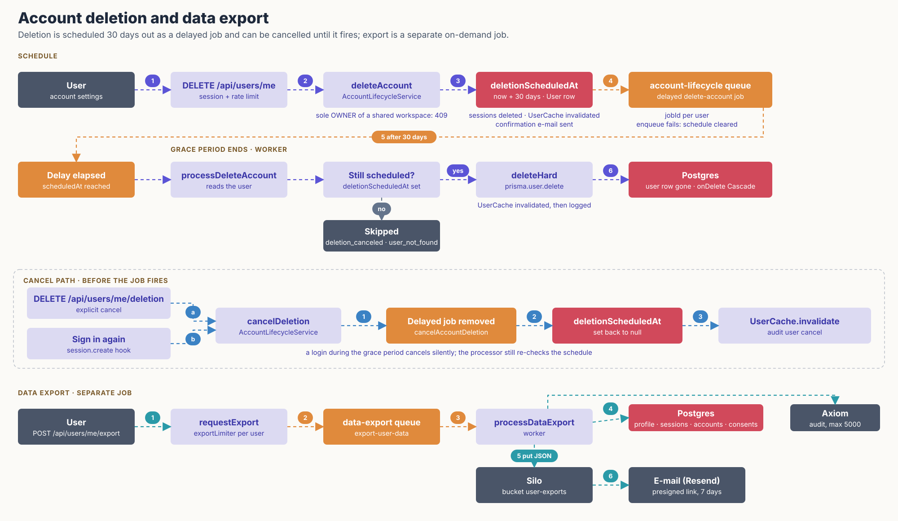

# User and account

Everything that belongs to one person regardless of workspace: the profile, preferences, notification settings, media (avatar and cover), cookie and terms consent, the data export and the scheduled account deletion. Authentication itself (sign-in, sessions, 2FA) is in [../architecture/auth.md](../architecture/auth.md). Onboarding steps and invitations are in [workspace-and-members.md](./workspace-and-members.md).

## Contract

`src/schemas/`:

- `user.schema.ts`: `UpdateUserSchema` (`name` 2-100, `username` 3-39 matching `^[a-z0-9._-]+$`, `coverImage` a relative path or URL). There is deliberately no `email` field: an earlier endpoint let a signed-in user rewrite their e-mail without verifying it, which with an e-mail based platform admin allowlist was a path to admin. The comment in the schema records this, and the service writes field by field as a second lock. Also `SaveProfileSchema` (with opt-in `marketingConsent`, default false), `SaveRoleSchema`, `SaveGoalsSchema`, `AcceptConsentSchema` (both flags must be literally true).
- `user-preference.schema.ts`: `UpdateUserPreferenceSchema` (`theme`, `smoothCursor`, `quickSendShortcut`, `timezone` validated with `Intl`, `weekStartsOn`, `weekendDays`, sidebar `navigation` and `homeWidgets`, where the client must send every item of a section so a payload can reorder or hide but never drop one). Defaults live in the same file.
- `notification-settings.schema.ts`: `priorityChanges`, `stateChanges`, `comments`, `mentions` booleans, at least one required.
- `user-export.schema.ts`: `UserExportPayloadSchema`, schema version `'1'`.

## Data model

`prisma/schema.prisma`: `User` (profile, `username` unique, `deletionScheduledAt`, `acceptedTermsAt`, `acceptedPrivacyAt`, `marketingConsentAt`, onboarding fields), `UserPreference` and `NotificationSetting` (one row per user, cascade), `ConsentEvent` (append-only consent log with IP and user agent), plus the Better Auth tables `Session`, `Account`, `TwoFactor`, `Verification`. Nearly every user-owned table cascades from `User`, so a hard delete removes the person's memberships, sticky notes, short links and so on in one statement; authored content in shared tables is set null where the schema says so (for example `WikiPage.createdById`).

## Service rules and authorization

All services act on the session's own user id (`/api/users/me/**`); there is no endpoint that reads or edits another user, so there is no ownership check to forget.

**Profile** (`src/services/user.service.ts`): `getProfile` reads `UserCache` (the DTO embeds memberships), `updateProfile` rejects a taken username with `USERNAME_CONFLICT`, re-reads and re-caches, and audits the changed field names. `acceptConsents` records terms and privacy acceptance with the current `TERMS_VERSION` and `PRIVACY_VERSION` (`lib/legal/versions.ts`), IP and user agent, and audits `documents`, `termsVersion`, `privacyVersion`.

**Preferences and notifications**: `user-preference.service.ts` (`get`, `update`, cache `pref:v3:`, 15 min TTL) and `notification-setting.service.ts` (cache `notif:`, 15 min). Updates invalidate and audit.

**Media** (`src/services/media/user-media.service.ts`): avatar to bucket `avatars`, cover to `user-covers`, through `POST /api/users/me/avatar` and `/cover` with `uploadLimiter`.

**Cookie consent** (`consent.service.ts`): see the workspace page; the route is `POST /api/users/me/cookie-consent`.

## Account deletion

`AccountLifecycleService.deleteAccount` (`src/services/account-lifecycle.service.ts`), called by `DELETE /api/users/me`:

1. If a deletion is already scheduled it returns the existing date (idempotent).
2. Refuses with `CONFLICT` when the user is the only `OWNER` of a workspace that still has other members (`UserRepository.countBlockingSoleOwnerWorkspaces`). A workspace where they are the only member does not block; it is removed with the user by cascade.
3. Sets `deletionScheduledAt` to now plus the grace period: 30 days (`ACCOUNT_DELETION_GRACE_DAYS` in `src/lib/queue/account-lifecycle.ts`), overridable with `ACCOUNT_DELETION_GRACE_OVERRIDE_MS` outside tests.
4. Enqueues a delayed BullMQ job (`scheduleAccountDeletion`). If enqueueing fails the schedule is cleared, so a user is never marked without a job.
5. Deletes all sessions, invalidates the cache, e-mails the user the date (a mail failure is only logged), audits `entity: user, action: delete`.

The worker (`src/lib/queue/processors/account-lifecycle.ts`, queue `account-lifecycle`, job `delete-account`) re-reads the user when the job fires. It skips with a log if the user is gone or `deletionScheduledAt` is null, otherwise runs `UserRepository.deleteHard` (a real `prisma.user.delete`) and invalidates the cache.

**Cancelling.** `DELETE /api/users/me/deletion` calls `cancelDeletion` (removes the job, clears the date, audits `cancel`). The same method also runs from the sign-in hook in `src/lib/auth.ts`: signing back in during the grace period cancels the deletion on purpose. A manual end-to-end test must not sign in again before the worker fires.

## Data export

`POST /api/users/me/export` calls `AccountLifecycleService.requestExport`: it consumes `exportLimiter` (keyed by user id), enqueues a job with `enqueueUserExport` and audits the request; an enqueue failure returns a database error. The processor (`src/lib/queue/processors/data-export.ts`) builds a JSON payload from Postgres (profile, sessions without tokens, linked accounts without secrets, consent events) plus up to `AUDIT_LOG_MAX_ENTRIES` (5000) audit entries read from the Axiom dataset, validates it with `UserExportPayloadSchema`, uploads it to bucket `user-exports`, and e-mails a presigned link valid `SIGNED_URL_TTL_SECONDS` (7 days). Workspace content such as issues or wiki pages is not part of the export. Whether that satisfies the LGPD access right is a legal decision not defined in this repository; the code only exports the sources listed above.

## LGPD handling

- Consent is recorded with document version, timestamp, IP and user agent (`ConsentEvent`, `User.accepted*At`). Marketing consent is opt-in only and audited separately.
- Terms acceptance is enforced at three layers: `proxy.ts` (optimistic, from the cookie cache), the DAL (`requireConsentedUser`) and API routes (`requireConsent`, `src/lib/consent.ts`).
- Erasure is the delayed hard delete above; access is the export above. Retention of expired sessions and tokens is the `data-retention` job (cron `0 3 * * *` UTC, `src/lib/queue/retention.ts`), see [../architecture/background-jobs.md](../architecture/background-jobs.md).
- Audit events carry ids and field names, not field values.

## Error codes

`USERNAME_CONFLICT` (409), `CONFLICT` (409, sole owner), `RATE_LIMITED` (429, export), plus the consent errors from `src/lib/consent.ts`.

## Routes

`app/api/users/me/`: `route.ts` (GET, PATCH, DELETE), `preferences` (GET, PATCH), `notifications` (GET, PATCH), `avatar` (POST), `cover` (POST), `cookie-consent` (POST), `export` (POST), `deletion` (DELETE = cancel). Most use `apiLimiter` per user.

## UI entry points

The account modal `app/_components/user/modal/` (profile, security, preferences, notifications tabs, with the deletion and export controls in the profile and security tabs), onboarding under `app/onboarding/`. Hooks: `src/hooks/use-user.ts`, `use-user-preferences.ts`, `user-notification-settings.ts`.

## Caching

`UserCache` (`user:v4:`), `UserPreferenceCache` (`pref:v3:`), `NotificationSettingCache` (`notif:`), all 15 min through `createKeyedCache` (`src/cache/_cache.ts`). Writers invalidate; see [../architecture/caching.md](../architecture/caching.md).

## Tests

- Unit: `src/services/__tests__/{user,user-preference,notification-setting,account-lifecycle,user-media}.service.test.ts`, `src/lib/__tests__/{account-lifecycle,account-lifecycle-processor,data-export-processor}.test.ts`.
- Integration: `src/repositories/__tests__/{user,user-preference,notification-setting}.repository.test.ts`, `src/cache/__tests__/`.
- E2E: `app/api/users/me/preferences/__tests__/preferences.e2e.test.ts`, `notifications/__tests__/notification.e2e.test.ts`.
- Component: `app/_components/user/modal/tabs/__tests__/`, `src/hooks/__tests__/use-user*.component.test.tsx`.

## Related files

`src/repositories/user.repository.ts`, `src/lib/queue/{account-lifecycle,data-export}.ts`, `src/lib/auth.ts` (cancel on sign-in), `lib/legal/versions.ts`.
