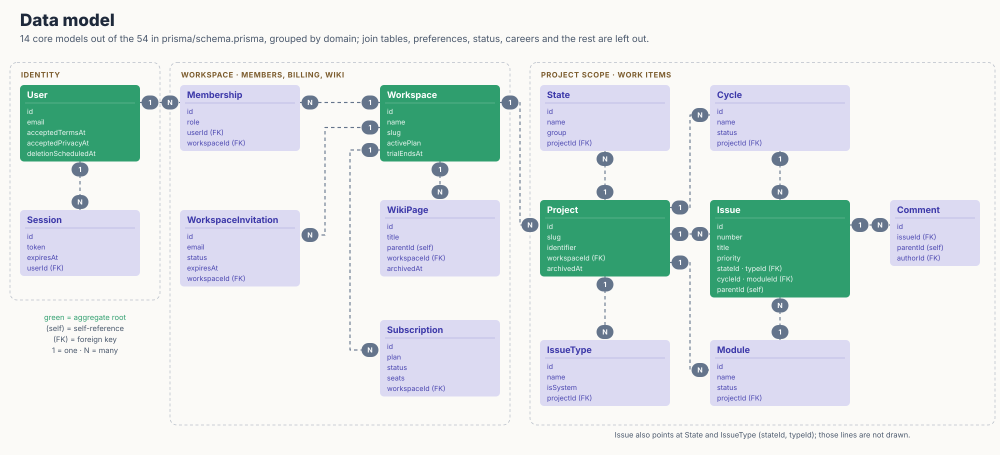

# Workspace, members, invitations, onboarding and consent

The workspace is the tenant. This page covers its lifecycle (create, update, delete), who belongs to it (`Membership`), how people get in (`WorkspaceInvitation`), the onboarding steps a new user walks through before they own one, and the consent records that gate everything. Tenant isolation as a concept lives in [../architecture/multi-tenancy.md](../architecture/multi-tenancy.md); this page is the feature-level view.

## Contract

Schemas are in `src/schemas/`:

- `workspace.schema.ts`: `CreateWorkspaceSchema` (`name` 2-100, `slug` 2-50 matching `^[a-z0-9-]+$`, optional `teamSize` from `TEAM_SIZES`). `UpdateWorkspaceSchema` is the same shape as a partial plus `timezone`, `membersCanCreateProjects`, `projectStatesEnabled`, `projectLabelsEnabled`.
- `invitation.schema.ts`: `CreateInvitationSchema` (`email`, `role` in `ADMIN | MEMBER | VIEWER` defaulting to `MEMBER`, optional `projectId`), `AcceptInvitationSchema` (`token`), `UpdateInvitationRoleSchema`, `InviteToProjectSchema`. `OWNER` can never be invited.
- `member.schema.ts`: `ListMembersQuerySchema` (`search`, comma separated `roles`, `sortBy`, `sortOrder`, `page`, `pageSize` max 100).
- `member-import.schema.ts`: one CSV row (`email`, `username`, `name`, `role`).

## Data model

All in `prisma/schema.prisma`:

- `Workspace`: unique `slug`, `activePlan` (`Plan`, default `FREE`), `trialEndsAt`, `teamSize`, `timezone`, and three settings switches (`membersCanCreateProjects`, `projectStatesEnabled`, `projectLabelsEnabled`).
- `Membership`: `userId`, `workspaceId`, `role` (`OWNER | ADMIN | MEMBER | VIEWER`), `@@unique([userId, workspaceId])`. Cascades from both user and workspace.
- `WorkspaceInvitation`: `email`, `role`, unique `token` (cuid), `status` (`InviteStatus`), `expiresAt` (column mapped as `expiresa_at`), `invitedById`, optional `projectId` (a project-scoped invite).
- `User` carries the onboarding state: `onboardingStep` (`PROFILE -> ROLE -> BRINGS -> WORKSPACE`, null when done), `role`, `goals`, `acceptedTermsAt`, `acceptedPrivacyAt`, `marketingConsentAt`.
- `ConsentEvent`: append-only log (`document` TERMS/PRIVACY/COOKIES, `version`, `action` GRANTED/REVOKED, IP, user agent).

<!-- DIAGRAM NEEDED: invitation-lifecycle: state diagram of WorkspaceInvitation (PENDING, ACCEPTED, EXPIRED, REVOKED) with the create/resend/revoke/accept transitions and the seat-limit checks; read src/services/invitation.service.ts and src/repositories/invitation.repository.ts -->

## Service rules and authorization

Authorization lives in the services, through `assertMember` / `assertPrivileged` in `src/services/_authz.ts` (privileged = `OWNER` or `ADMIN`).

**Workspace** (`src/services/workspace.service.ts`)
- `getById`: any member; reads `WorkspaceCache` only after the membership check.
- `create`: any signed-in user. `WorkspaceRepository.createWithOwner` runs one transaction: workspace, the default project states, the `OWNER` membership, and sets the creator's `onboardingStep` to null. The workspace starts on the trial: `TRIAL_PLAN` (`BUSINESS`) for `TRIAL_DAYS` (14), from `src/config/trial.ts`.
- `update`: `OWNER` or `ADMIN` only (`forbidden` otherwise, audited as `insufficient_role`).
- `delete`: `OWNER` only, and refused with `WORKSPACE_HAS_ACTIVE_PLAN` while `activePlan` is not `FREE`, so billing is cancelled first. The logo object is removed from storage after the row is gone.
- Each mutation emits `auditMutation` (success and failure).

**Members** (`member.service.ts`, `membership.service.ts`)
- `list`: privileged only. Filtering is done in the repository, sorting and paging in memory.
- `import` (CSV): privileged only and gated by `can(plan, 'importMembersCsv')` (`PRO` and above, `src/config/plans.ts`), else `FEATURE_NOT_IN_PLAN`. Rows are invited one by one, sequentially, so the seat check cannot race. `INVITATION_DUPLICATE` and `INVITATION_ALREADY_MEMBER` become `skipped`; other failures become `error` rows. The CSV is parsed by `src/lib/csv/member-import-parser.ts` (papaparse; required headers `email,username,name,role`).
- `MembershipService` is read-only (`getByUserAndSlug`, `listByUser`, `countByWorkspace`).
- There is no route to change a member's role or remove a member: `app/api/workspaces/[id]/members/` has only `GET` and `import`. TODO: confirm whether that is intentional.

**Invitations** (`invitation.service.ts`)
- Workspace invites (create, list, revoke, resend, change role): privileged only. Project invites (`createForProject`, ...): the workspace admin or the project lead (`assertProjectManager`); an existing workspace member is added to the project directly instead of invited.
- Emails are lower-cased. Creating fails with `INVITATION_ALREADY_MEMBER` or `INVITATION_DUPLICATE` (an expired pending invite is flipped to `EXPIRED` and replaced).
- Seats: `limitOf(plan, 'seats')`; creating counts members plus pending invites, accepting counts members only. `null` means unlimited. Over the cap returns `SEAT_LIMIT_REACHED`. The repository re-checks inside its transaction.
- TTL is 7 days. `resend` rotates the token and expiry and works on `PENDING` or `EXPIRED`; `revoke` and `updateRole` require `PENDING`.
- `accept` (the actor is the invitee): checks status and expiry, requires the session email to equal the invite email (`INVITATION_EMAIL_MISMATCH`), then creates the membership (and a `ProjectMember` for project invites) in a transaction and invalidates `UserCache`.
- The email is sent best effort (`sendInviteUserToWorkspaceEmail`); a send failure is logged as `invitation.email_failed` and does not fail the call.

**Onboarding** (`onboarding.service.ts`): each step saves its data and moves `onboardingStep` forward (`saveOnboardingProfile`, `saveOnboardingRole`, `saveOnboardingGoals`, `completeOnboardingStep`, `goBackOnboardingStep`). Profile can record marketing consent, which gets its own audit event. Routing is decided by `app/onboarding/_lib/destination.ts` (consent first, then the step; a user who already has memberships skips the first three steps).

**Consent**: terms and privacy acceptance is `UserService.acceptConsents` (see [user-and-account.md](./user-and-account.md)), called from the `acceptOnboardingConsent` server action (`app/onboarding/_actions/consent-setup.ts`), which also clears the signed session-data cookie so the proxy stops redirecting. Cookie consent is `ConsentService.recordCookieConsent` (`consent.service.ts`): idempotent against the latest recorded action, writes a `ConsentEvent` with IP and user agent.

## Error codes

`src/errors/codes.ts`: `FORBIDDEN`, `SEAT_LIMIT_REACHED` (403), `FEATURE_NOT_IN_PLAN` (403), `INVITATION_EMAIL_MISMATCH` (403), `INVITATION_NOT_FOUND` (404), `INVITATION_NOT_PENDING` (409), `INVITATION_EXPIRED` (410), `INVITATION_DUPLICATE` (409), `INVITATION_ALREADY_MEMBER` (409), `WORKSPACE_HAS_ACTIVE_PLAN` (409), `MEMBER_IMPORT_INVALID_FORMAT` and `MEMBER_IMPORT_EMPTY` (422).

## Routes and UI

| Route | Methods | Notes |
|---|---|---|
| `app/api/workspaces/route.ts` | POST | create |
| `app/api/workspaces/[id]/route.ts` | GET, PATCH, DELETE | |
| `app/api/workspaces/[id]/logo/route.ts` | POST, DELETE | `uploadLimiter`, `WorkspaceMediaService` (bucket `workspace-logos`) |
| `app/api/workspaces/[id]/members/route.ts` | GET | list |
| `app/api/workspaces/[id]/members/import/route.ts` | POST | CSV upload |
| `app/api/workspaces/[id]/invitations/route.ts` | GET, POST | |
| `app/api/workspaces/[id]/invitations/[invitationId]/route.ts` | PATCH, DELETE | role change, revoke |
| `app/api/workspaces/[id]/invitations/[invitationId]/resend/route.ts` | POST | |
| `app/api/invitations/accept/route.ts` | POST | |
| `app/api/workspaces/[id]/projects/[slug]/members/invite/**` | | project-scoped invites |

Routes use `apiLimiter` per user (logo uses `uploadLimiter`).

UI entry points: `app/onboarding/{profile,role,goals,workspace,consent}-setup`, `app/(private)/create-workspace`, `app/(public)/invite/accept` (`accept-invitation.tsx`), `app/(private)/[workspace-slug]/settings` (general form, logo and delete dialogs), `settings/members` (`members-manager.tsx`, `pending-invitations-list.tsx`). Client hooks: `src/hooks/use-workspace.ts`, `use-member.ts`, `use-invitation.ts`.

## Caching

- `WorkspaceCache` (`src/cache/workspace.cache.ts`): key prefix `workspace:v5:`, TTL 15 min. The prefix is bumped whenever the DTO gains a field.
- `UserCache` (`src/cache/user.cache.ts`, `user:v4:`, 15 min) embeds memberships, so create, update, delete and accept invalidate it (all members for update and delete).
- See [../architecture/caching.md](../architecture/caching.md).

## Queues

None directly. Workspace data is not touched by the BullMQ processors on this page's paths. TODO: confirm for the account-deletion processor (see [user-and-account.md](./user-and-account.md)).

## Gotchas

- The cache is read after the membership check, never before.
- Seat limits are counted differently on create (members plus pending) and accept (members only).
- `trialEndsAt` is set at creation; expiry handling is in [billing-and-coupons.md](./billing-and-coupons.md).

## Tests

- Unit: `src/services/__tests__/{workspace,member,membership,invitation,invitation-project,onboarding,consent}.service.test.ts`; schemas in `src/schemas/__tests__/`; mappers in `src/mappers/__tests__/`.
- Integration: `src/repositories/__tests__/{workspace,membership,invitation,invitation-project,consent}.repository.test.ts`, `src/cache/__tests__/workspace.cache.test.ts`.
- Component: `src/hooks/__tests__/use-{workspace,member,invitation}.component.test.tsx`, `app/onboarding/consent-setup/_components/__tests__/`.
- E2E: `app/api/__tests__/consent-gate.e2e.test.ts`, `app/api/auth/__tests__/sign-up-consent.e2e.test.ts`, `app/(private)/__tests__/access.e2e.test.ts`.

## Related files

`src/services/_authz.ts`, `src/config/trial.ts`, `src/lib/dal.ts`, `proxy.ts` (consent gate), `src/repositories/{workspace,membership,invitation,consent}.repository.ts`.
