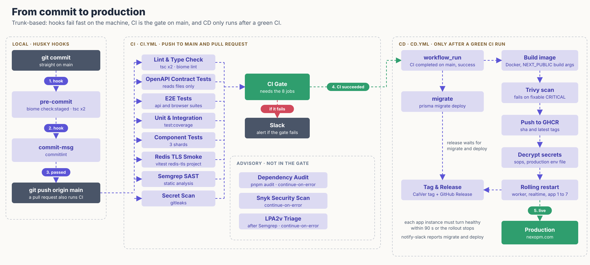
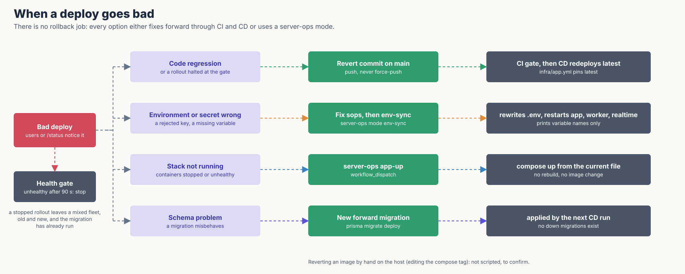

# Deploy

## Purpose

How a commit on `main` reaches production: the CD workflow, in what order it migrates, builds, scans, rolls out and releases, and what to do when a step fails. The source of truth is `.github/workflows/cd.yml`; this page explains it. The architecture-level view is in [infrastructure](../architecture/infrastructure.md).

## How it works

### Trigger

`cd.yml` runs on `workflow_run` of the workflow `CI` for `main`, and every job is guarded by `workflow_run.conclusion == 'success'`. A red CI never reaches production. CI itself skips pushes that touch only root `*.md` or `LICENSE` (`paths-ignore` in `ci.yml`), so those never deploy. Concurrency group `cd-production` queues deploys and never cancels one: a deploy that already migrated must finish.

### Jobs

1. **migrate** (self-hosted runner, which is the production host): checkout, Node 24, corepack pnpm, HugeIcons registry `.npmrc`, `pnpm install --frozen-lockfile`, then `pnpm prisma:deploy` (`prisma migrate deploy`) with `DATABASE_URL` set to the secret `DATABASE_URL_MIGRATE`. Migrations never go through the pooled URL.
2. **deploy** (self-hosted, environment `production`, `https://nexopm.com`). In order:
   - log in to GHCR; compute tags `<sha>` and `latest` (`docker/metadata-action`);
   - build the image with `load: true`, `push: false`, `pull: true` (so base-image fixes are picked up); `NEXT_PUBLIC_*` values, `NEXT_DEPLOYMENT_ID` and `NEXT_PUBLIC_SENTRY_RELEASE` (both the head SHA) are build args; the HugeIcons and Sentry tokens are BuildKit secrets;
   - **Trivy** scan, fails the deploy on `CRITICAL` with a fix available (`ignore-unfixed`); HIGH stays visible but does not block;
   - push the scanned image under both tags;
   - decrypt `secrets/production.enc.env` with sops into `/var/www/nexo/.env`, and append `SLACK_ALERTS_WEBHOOK_URL` from the CI secret `SLACK_WEBHOOK_URL` unless sops already defines it;
   - copy `infra/app.yml` to `/var/www/nexo/docker-compose.yml` and `infra/prod.yml` to `docker-compose.infra.yml` (the second is copied, never applied);
   - `docker compose pull`, then `up -d --no-deps nexo-worker nexo-realtime`;
   - **rolling restart** of `nexo-app-1` to `nexo-app-7`, one at a time: `up -d --no-deps <svc>`, then poll `docker inspect` health up to 30 times at 3 s. If an instance is not `healthy` after 90 s the job prints the last 50 log lines and exits 1, leaving the remaining instances on the old image;
   - `docker image prune -f` and `docker builder prune -f --filter until=168h`.
3. **release** (hosted runner, after migrate and deploy succeed): creates a CalVer tag and a GitHub Release. See [release-and-versioning.md](./release-and-versioning.md).
4. **notify-slack**: runs `always()` once migrate and deploy were not skipped; posts "Deploy succeeded" or "Deploy failed" with branch, author, commit and a link to the run.

### Health check

The container health check is `wget --spider http://127.0.0.1:3000/api/health` every 5 s (3 s timeout, 3 retries, 15 s start period; `infra/app.yml`). `/api/health` runs `SELECT 1` and answers 200 or 503, so an instance whose database is unreachable never becomes healthy and stops the rollout. nginx removes a failing instance from rotation (`max_fails=3 fail_timeout=10s`, `infra/nginx/nexo-upstream.conf`).

## Key decisions and why

- **Migrate before deploy, on the host.** The schema is changed while old instances still serve; migrations must be backward compatible with the previous image.
- **One image, three processes.** App, worker and realtime come from the same tag; the worker and realtime restart first.
- **Scan before push**, so a CRITICAL vulnerability never lands in the registry under `latest`.
- **Infra is not applied by CD.** Postgres, Redis, PgBouncer and Silo change only through the `server-ops` workflow.

## Rollback

There is no rollback job in the repository. What the code supports (see [runbooks.md](./runbooks.md)):

- Every deploy pushes an image tagged by commit SHA next to `latest`, but `infra/app.yml` pins `latest`. Reverting means pushing a revert commit to `main` and letting CI and CD run, or editing the compose tag on the host by hand (not scripted and not defined in this repository; `server-ops` has no mode for it).
- Migrations are forward-only (`prisma migrate deploy`); there are no down migrations. A schema rollback is a new migration.
- `server-ops` has `app-up` (bring the app stack up from the current compose file, no rebuild) and `env-sync` (rewrite `.env` from sops and restart), not an image rollback.

*The options when a deploy goes bad: there is no rollback job.*

## Gotchas

- The deploy and migrate jobs run on the same machine as the app, backups and the status collector; heavy jobs slow probes (see [status-page](../architecture/status-page.md)).
- A failed health gate leaves a mixed fleet (some instances new, some old) and no automatic revert. The migration has already run.
- The `release` job runs only if both `migrate` and `deploy` succeed; a deploy that stops at the health gate produces no tag.
- `CLAUDE.md` says CD deploys after CI; it does not mention that docs-only root markdown pushes skip both.
- `env-sync` restarts the whole application stack from `docker compose up -d` without waiting for a build.

## Related files

- `.github/workflows/ci.yml`, `.github/workflows/cd.yml`, `.github/workflows/server-ops.yml`
- `Dockerfile`, `infra/app.yml`, `infra/prod.yml`, `infra/nginx/nexo-upstream.conf`
- `secrets/production.enc.env` (encrypted)
- `app/api/health/route.ts`
