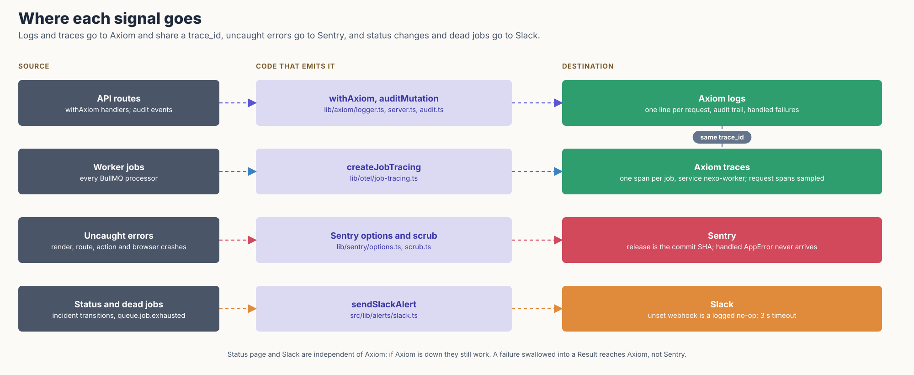

# Observability

## Purpose

What Nexo emits and where it goes: Axiom logs and traces, the audit trail, Sentry, Slack alerts and the public status page; which event names are contracts that something else depends on; and how to follow one request or job across them. The split between tools is explained in `lib/sentry/options.ts` and summarised here.

## How it works

### Division of labour

| Tool | Holds | Source |
| --- | --- | --- |
| Axiom logs | One line per API request, the audit trail, handled failures (rate limit hit, Slack timeout, mapped Prisma error), web vitals | `lib/axiom/` |
| Axiom traces | Sampled request spans and one span per background job | `lib/otel/` |
| Sentry | Uncaught exceptions only (render, route and action crashes; browser handlers). A mapped `AppError` never reaches it | `lib/sentry/`, `instrumentation.ts`, `sentry.*.config.ts` |
| Slack | Status transitions and dead jobs | `src/lib/alerts/slack.ts` |
| Status page | Probe history and incidents | [status-page](../architecture/status-page.md) |
| PostHog | Product analytics through the same-origin `/ingest` rewrite; off without `NEXT_PUBLIC_POSTHOG_KEY` | `next.config.ts` |

### Axiom logs

`lib/axiom/logger.ts` builds one `Logger` writing to the dataset `NEXT_PUBLIC_AXIOM_DATASET` (an ingest-only public token; plus a console transport outside production). `withAxiom` (`lib/axiom/server.ts`) wraps route handlers and logs request success and error. It deliberately does not flush per request: per-request flushes queued up and exhausted the heap in production on 2026-10-16 (comment in that file), so the batching client sends. Every line carries `trace_id` and `span_id` when written inside a span (`lib/otel/trace-context.ts`).

### Audit events

`lib/axiom/audit.ts` writes structured audit lines with `category: 'audit'`:

- `auditMutation({ entity, action, actorId, targetId?, outcome?, reason?, meta? })` logs `audit.mutation.<entity>.<action>` (entities such as `user`, `workspace`, `project`, `issue`, `wiki_page`, `consent`; actions such as `create`, `update`, `delete`, `archive`, `export_requested`).
- `auditAuth({ event, userId?, outcome?, ... })` logs `audit.auth.<event>`: `user.created`, `session.created`, `auth.sign_in.success`, `auth.sign_in.failure`, `auth.2fa_enabled`, `auth.reset_password.requested`, `auth.admin_access.denied`, and others.
- `auditAccess({ event: 'consent.gate.blocked', ... })` logs `audit.access.consent.gate.blocked` (warning) when the consent gate refuses a request, with reason `CONSENT_MISSING` or `USER_LOOKUP_FAILED`.

A `failure` outcome logs at `warn`, a success at `info`. The union types in `audit.ts` are the exhaustive list; adding an entity or event means extending them. These lines are LGPD evidence, so their names and `actorId`/`outcome` fields should be treated as stable.

### Events that are contracts

| Event | Where | Who depends on it |
| --- | --- | --- |
| `queue.job.exhausted` and its fields (`queue`, `jobName`, `jobId`, `attemptsMade`, `maxAttempts`, `reason`, `message`, `stack`, `payload`) | `src/lib/queue/failure-alarm.ts` | An Axiom monitor. The code comment says renaming silently disables the alarm; change the monitor in the same commit. The monitor is not in the repository: TODO: confirm where it is defined |
| `alerts.slack.failed` | `src/lib/alerts/slack.ts` | Visibility of a broken alert channel; never contains the webhook URL |
| `audit.*` names | `lib/axiom/audit.ts` | Compliance queries |

Other event families (not contracts, but useful as search keys): `queue.job.completed|failed|stalled`, `queue.worker.started|error|bootstrap_error|shutdown_*`, `queue.scheduler.*_registered`, `queue.account_lifecycle.*`, `queue.data_retention.*`, `queue.data_export.*`, `queue.trial_lifecycle.*`, `status.*_failed`, `rate_limit_violation`, `rate_limit_store_error`, `redis.connection_error`, `repository.database_error`, `realtime.*`, `subscription.gateway_failed`, `subscription.amount_mismatch`, `talk_to_sales.*`.

### Traces for jobs

The worker is a bundled process outside Next, so Sentry's auto-instrumentation is absent. `createJobTracing` (`lib/otel/job-tracing.ts`) wraps each processor so every job gets a span (queue, attempt, exception) with service name `nexo-worker`, exported to the Axiom traces dataset. Without `AXIOM_TRACES_TOKEN` it is a no-op. Logs the job writes carry the same `trace_id`, so you move from a failure log to the span and back by that id. Request traces in the Next app are sampled at `TRACES_SAMPLE_RATE` when the token is set, otherwise Sentry's own defaults apply (10% in production, per the comment in `lib/sentry/options.ts`).

### Slack alerts

`sendSlackAlert` posts `{ text }` to `SLACK_ALERTS_WEBHOOK_URL`; unset is a logged no-op; 3 s timeout; never throws. Senders: status incident transitions (`status.transition|unstable|stabilized|reminder`, `status.collect_failed|collect_recovered`) and `queue.job.exhausted`. Text passes through `sanitizeAlertText` (strips e-mails, URL credentials, bearer tokens). Details in [status-page](../architecture/status-page.md) and [background-jobs](../architecture/background-jobs.md).

### Sentry

Errors are scrubbed before sending (`lib/sentry/scrub.ts`): cookies, authorization headers, request bodies and secret-looking query parameters are removed, e-mails and tokens masked. Release is the commit SHA (`NEXT_PUBLIC_SENTRY_RELEASE`), set only in the CD build, which is also the only place source maps are uploaded.

## Following one incident

1. Get the `trace_id` from the log line (Axiom logs dataset).
2. Filter the traces dataset by it for the waterfall.
3. For a user-reported action, search `audit.*` by `actorId`.
4. For a crash, find the matching Sentry issue by release (commit SHA).

*Where each signal goes: Axiom logs and traces, Sentry and Slack.*

## Gotchas

- Do not log full job payloads: only `userId` and `workspaceId` are allowlisted for alerts and logs.
- Services return `Result`, so handled failures appear in Axiom, not Sentry. A bug that is swallowed into a `Result` will not page anyone; the failed-job alarm exists for that reason.
- A missing request log for a short-lived process is usually an unflushed batch.
- Public status and Slack are independent of Axiom; if Axiom is down, those still work.

## Related files

- `lib/axiom/{logger,server,audit,axiom}.ts`
- `lib/otel/{job-tracing,axiom-traces,trace-context}.ts`
- `lib/sentry/{options,scrub}.ts`, `instrumentation.ts`, `instrumentation-client.ts`
- `src/lib/alerts/slack.ts`, `src/lib/queue/failure-alarm.ts`
