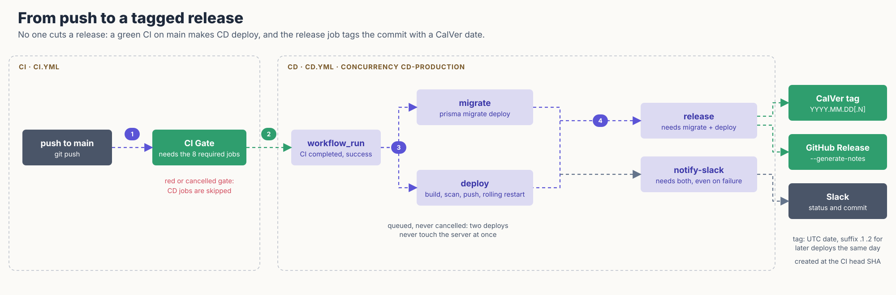

# Release and versioning

## Purpose

How versions are named, how a release is cut and where release notes come from. Releases are created automatically by CD after a successful deploy; nobody tags by hand.

## How it works

### CalVer tags

`cd.yml` job `release` computes a UTC date `YYYY.MM.DD`. The first release of a day has no suffix (`2026.10.29`); each further deploy that day gets `.N` where N is the number of tags already existing for that date (`2026.10.28.1`, `.2`, ...). The script counts `git tag --list "$TODAY" "$TODAY.*"`.

```
EXISTING=$(git tag --list "$TODAY" "$TODAY.*" | wc -l)
if [ "$EXISTING" -eq 0 ]; then TAG="$TODAY"; else TAG="$TODAY.$EXISTING"; fi
gh release create "$TAG" --target "$SHA" --title "$TAG" --generate-notes
```

`gh release create` makes the tag and the GitHub Release together at the deployed commit (`workflow_run.head_sha`) and generates notes from the commits since the previous release. The job checks out the default branch with `fetch-depth: 0` and `persist-credentials: false` on purpose: it holds `contents: write`, so it must not check out the untrusted `workflow_run` ref (comment in `cd.yml`).

### History in this repository

- The first tag, `2026.05.20`, is an annotated tag created by hand ("primeira release CalVer"). The automation arrived in commit `91087744` ("ci(release): automate GitHub Releases", 2026-05-20).
- As of this writing there are 131 tags, the latest by date `2026.11.01`. The busiest day is `2026.10.28` with 18 tags (`2026.10.28` through `2026.10.28.17`).
- Tags are immutable: never move or delete one, and never force-push `main` ([ADR 0001](../adr/0001-trunk-based-development.md)).

### What a tag means

A tag is a deploy, not a decision. Because every green push to `main` that is not docs-only deploys, tags accrue as often as commits. A tag exists only if migrate and deploy both succeeded (`needs: [migrate, deploy]`).

The running application knows its commit: `NEXT_DEPLOYMENT_ID` and `NEXT_PUBLIC_SENTRY_RELEASE` are the head SHA, baked at build time. Sentry releases therefore match commits, not CalVer tags. TODO: confirm whether the tag is exposed anywhere at runtime.

## Cutting a release

You do not. Push to `main`, wait for CI, and CD tags. To check what shipped: `git tag --sort=creatordate | tail`, then `git log <previous>..<tag>`.



*From a push to main to a CalVer tag, a GitHub Release and a Slack message.*

## Key decisions and why

- **CalVer over SemVer.** The product is a continuously deployed web app with no consumers of a library API, so a date identifies a deploy better than a compatibility promise (inferred; the commit that adopted CalVer states only "primeira release CalVer").
- **Generated notes, not a hand-kept file.** `--generate-notes` removes release-day work. User-facing notes live in the public changelog, see [../changelog/README.md](../changelog/README.md).

## Gotchas

- Race: two deploys on the same day count existing tags at the moment the release job runs; CD concurrency (`cd-production`) serializes deploys so the count is stable.
- The OpenAPI document has its own `info.version` (`1.0.0`) that is not tied to tags.
- A docs-only root `*.md` push neither deploys nor tags.
- The vault (outside this repo) keeps a `Changelog/` folder of dated release writeups, per `CLAUDE.md`; it is not part of this repository.

## Related files

- `.github/workflows/cd.yml` (job `release`)
- `git tag`, commit `91087744`
- [deploy.md](./deploy.md)
