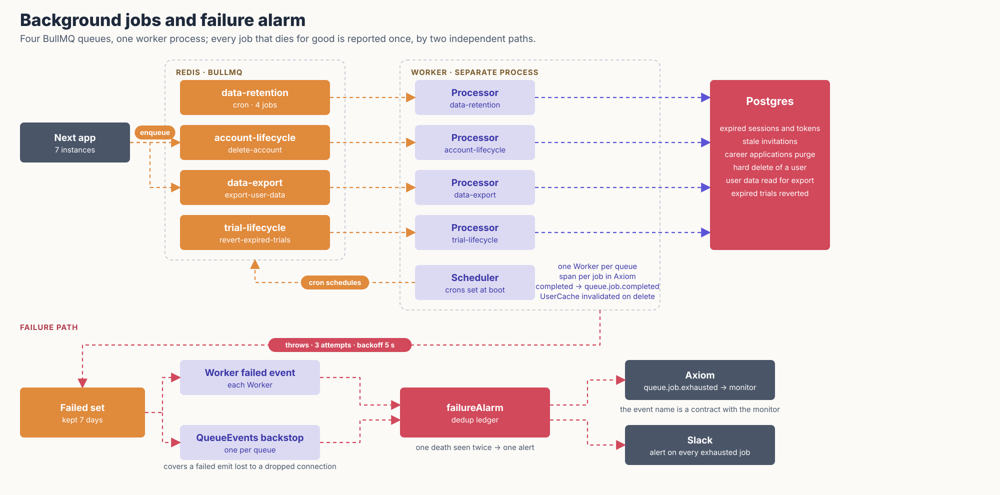
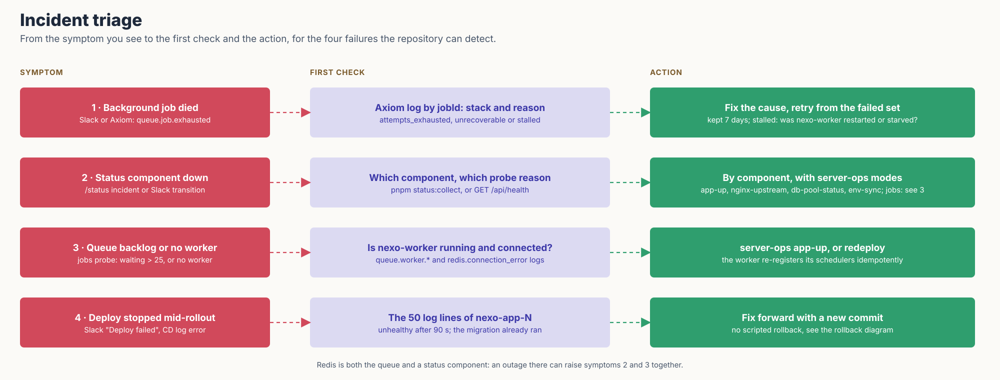

# Runbooks

## Purpose

Symptom, check, action, for the failures the repository itself can detect or fix. Every step is backed by a script, workflow, probe or code comment cited next to it. Anything the repository does not show is stated as "not defined in this repository"; this page does not describe server procedures that live only on the host (backup script internals, nginx server blocks, certificates).

Access note: production work goes through the `server-ops` workflow (`workflow_dispatch`, `.github/workflows/server-ops.yml`), because the self-hosted runner is the server and every action leaves a log. There is no SSH-based procedure in the repository.

## 1. Slack: "background job died" (`queue.job.exhausted`)

- **Symptom.** A Slack message from the worker alarm, or an Axiom monitor hit on the event `queue.job.exhausted` (`src/lib/queue/failure-alarm.ts`).
- **Check.** The message and log fields name `queue`, `jobName`, `jobId`, `attemptsMade`, `maxAttempts`, `reason` (`attempts_exhausted`, `unrecoverable`, `stalled`) and the sanitized error. Payload ids are only `userId` and `workspaceId`. Look up the cause in Axiom (log has the stack, Slack does not) by `jobId`, and the job's trace in the traces dataset by `trace_id` ([observability.md](./observability.md)).
- **Action.** Fix the cause first (the classic case was a foreign key, see [the delete-account postmortem](../postmortems/2026-09-20-delete-account-foreign-key.md)), then retry the job from the BullMQ failed set; a manual retry that dies again counts as a new death and alerts again. Failed jobs are kept 7 days (`src/lib/queue/queues.ts`), so act inside that window. To retry, use the queue dashboard mounted at `/admin/queues` (`app/(private)/admin/queues/[[...workbench]]/route.ts`): it needs a platform admin with 2FA plus basic auth with `WORKBENCH_USER`/`WORKBENCH_PASS` (`lib/env/_server-admin.ts`), and can retry, remove and promote jobs (see [admin](../domains/admin.md)).
- **Reason `stalled`.** The worker lost its lock; check whether `nexo-worker` was restarted or starved of CPU.

## 2. `/status` shows a component down or degraded

- **Symptom.** Public status page, an incident row, or a Slack transition message ("unstable", "stabilized", reminder every 6 h) from `status-alerts.ts`.
- **Check.** Which component (`app`, `database`, `cache`, `auth`, `payment`, `email`, `jobs`, `storage`; `src/services/status/components.ts`) and the probe's reason. Reproduce with `pnpm status:collect` against local env, or call the app's `/api/health`.
- **Action by component.**
  - `app`: `GET {NEXT_PUBLIC_URL}/api/health` through DNS, nginx and TLS fails. Check the deploy ran (a halted rollout leaves old and new instances) and nginx upstream health; `server-ops` modes `app-up`, `nginx-upstream`.
  - `database`: `SELECT 1` fails. `server-ops` `db-pool-status` shows connections and PgBouncer pools; `replication-status` shows the standby.
  - `payment` / `email`: HTTP 401 or 403 from the provider counts as an outage on purpose: the key was rejected. Check the key in sops, then `env-sync`.
  - `storage`: S3 `ListBuckets` with our credentials fails. See the [MinIO postmortem](../postmortems/2026-09-24-minio-image-withdrawn.md) for the image history.
  - `jobs`: a queue has no connected worker, or more than 25 waiting jobs. See runbook 3.
- **Action, collector itself.** If no new checks appear, the scheduler that calls `POST /api/status/collect/{core,peripheral}` is not defined in this repository (see [status-page.md](../architecture/status-page.md)); check it on the host. A held outage with the 6 h reminder is expected behaviour, not a loop.
- **No alert is sent when the database is down** because incidents cannot be written; instead `status.collect_failed` and `status.collect_recovered` post once per edge.

## 3. Queue backlog or no worker

- **Symptom.** `jobs` probe degraded ("waiting > 25") or outage ("no worker connected").
- **Check.** Is `nexo-worker` running (`docker ps` output is printed by `server-ops` `app-up`, which also shows health)? Logs `queue.worker.started` / `queue.worker.error` / `queue.worker.bootstrap_error`, `queue.connection_error`, `redis.connection_error` (Redis TLS settings `REDIS_TLS_ENABLED`, `REDIS_TLS_CA_PATH`).
- **Action.** Bring the stack up with `server-ops` `app-up`, or redeploy. The worker re-registers its cron schedulers on boot idempotently (`upsertJobScheduler`), so a restart never duplicates them. Delayed jobs (such as account deletions 30 days out) do not count towards the backlog.

## 4. A deploy stopped mid-rollout

- **Symptom.** Slack "Deploy failed"; the CD log shows `::error::nexo-app-N is <status> after 90s, stopping the rollout`.
- **Check.** The 50 log lines printed by the step. The migration for this commit has already run (job `migrate` precedes `deploy`).
- **Action.** Fix forward with a new commit. There is no scripted rollback; see "Rollback" in [deploy.md](./deploy.md). Instances after the failing one still run the previous image, which is why migrations must stay backward compatible.

## 5. CI is red on `main`

- **Symptom.** `CI Gate` fails; no CD run follows.
- **Check.** The gate requires `lint`, `contract-tests`, `e2e-tests`, `coverage-tests`, `component-tests`, `semgrep`, `gitleaks`, `redis-tls-smoke`. Audit, Snyk and LPA2v are not in the gate. A new route without an OpenAPI entry fails `contract-tests`.
- **Action.** Fix on `main` with a small commit; never force-push (ADR 0001).

## 6. A secret or variable changed

- **Action.** Edit `secrets/production.enc.env` with sops (verify by variable names only, never by diffing decrypted values), push, and either wait for a deploy or run `server-ops` `env-sync`, which rewrites `.env` and restarts the app, worker and realtime services. It prints variable names only.

## 7. Database or storage infrastructure change

- **Action.** `cd.yml` copies `infra/prod.yml` but does not apply it. Run `server-ops` `compose-diff` first (read-only), then `infra-apply`, which also reports containers that no compose file declares (never removes them). `backup-inspect` and `backup-run` exist for the nightly backup (the script lives at `/usr/local/sbin/nexo-backup.sh` on the host, not in the repository).

*From the symptom to the first check and the action, for runbooks 1 to 4.*

## Gotchas

- Redis is both the queue and a status component; a Redis outage looks like several symptoms at once (`cache`, `jobs`, rate limiting fails open).
- Do not paste decrypted secrets or webhook URLs anywhere; the Slack webhook is never logged by design.
- `nexo-db-1` and `nexo-minio-1` names are load-bearing; do not rename them in compose files.

## Related files

- `.github/workflows/server-ops.yml`, `.github/workflows/cd.yml`
- `src/lib/queue/failure-alarm.ts`, `src/lib/queue/queues.ts`, `worker/index.ts`
- `src/services/status/probes.ts`, `status-alerts.ts`
- [../architecture/background-jobs.md](../architecture/background-jobs.md), [../architecture/status-page.md](../architecture/status-page.md)
