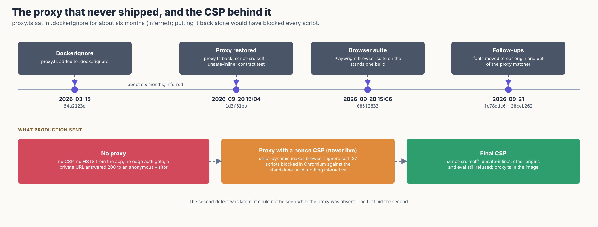

# 2026-09-20: the proxy missing from the image, and a CSP that could not hydrate

## Summary

`proxy.ts` (the edge entry: security headers and the auth gate) was listed in `.dockerignore`, so every production image was built without it. Production therefore served no Content-Security-Policy, no HSTS from the app, and no edge auth gate. Putting the file back alone would have broken the site: the CSP it carried used a per-request nonce with `'strict-dynamic'`, which blocks the scripts of a prerendered shell. The two problems were fixed together in `1d3f61bb` (2026-09-20 15:04 -0300).

## Impact

- From the commit message: live `nexopm.com` sent no CSP and no HSTS from the app, and "a private URL answered 200 for an anonymous visitor instead of redirecting to sign-in". The page-level gate in the DAL was a separate layer, so the extent of what an anonymous visitor could read is not stated: TODO: confirm.
- Duration (inferred): `.dockerignore` gained the `proxy.ts` line in `54a2123d` (2026-03-15, "optimize image size and build context"); the file already existed under that name in that tree. The defect therefore plausibly lasted from March to 2026-09-20, about six months, assuming images were built from that context throughout.
- Users affected: not recorded.

## Timeline

- 2026-03-15, `54a2123d`: `proxy.ts` added to `.dockerignore` under "Dev tools & config" (the name reads like tooling).
- 2026-09-20 15:04, `1d3f61bb`: `proxy.ts` removed from `.dockerignore`; `script-src` becomes `'self'` plus `'unsafe-inline'`; a contract test is added.
- 2026-09-20 15:06, `08512633`: Playwright browser suite against the standalone artifact, the layer that exposed the CSP problem.
- 2026-09-21, `fc78ddc6` and `28ceb262`: follow-ups once the proxy ran for real: excalidraw fonts moved to our origin, and fonts excluded from the proxy matcher (they were hitting the auth gate and getting a 307).

*From proxy.ts entering .dockerignore to the final CSP, and what production sent at each stage.*

## Root cause

1. **Build context.** A file the server needs was excluded from the Docker build context. A missing file in a build context fails silently; the build never complained.
2. **CSP incompatible with Cache Components.** With `cacheComponents` the shell is prerendered at build time, so its bootstrap scripts have no nonce, and `'strict-dynamic'` makes browsers ignore `'self'`. Verified in Chromium against the standalone server: 27 scripts blocked, nothing interactive. Hashes are not a way out either, since about 50 inline scripts Next streams differ on every request.

The second defect was latent: it could not be seen while the proxy was absent. The first hid the second.

## Detection

Found by the owner while building the browser suite. The commit says the standalone-versus-`next start` difference "is what exposed the CSP bug": every other test layer speaks HTTP or renders in jsdom, where browser CSP enforcement never happens. The missing proxy was found by inspecting live responses (no CSP, no HSTS, 200 on a private URL).

## Resolution

- `.dockerignore` no longer lists `proxy.ts`.
- `script-src 'self' 'unsafe-inline'`: still refuses other origins and eval in production. The nonce plumbing was removed because nothing consumed `x-nonce`; it works again if `cacheComponents` is turned off.

## Guards added

- `src/__tests__/contract/dockerignore.contract.test.ts`: fails if `.dockerignore` drops something the server needs, naming the file.
- The browser suite (`pnpm test:browser`, `e2e/specs`) boots `node .next/standalone/server.js` and runs without `bypassCSP`.
- [ADR 0006](../adr/0006-standalone-output-and-browser-tests.md) records the decision.

## Lessons

- Test what ships: the artifact, in a browser, with the CSP on.
- A missing file in an ignore list is a silent failure; encode "what the server needs" as a test.
- Security headers that are tested only where they are set will not notice they are never set.

## Related files

- `.dockerignore`, `proxy.ts`, `next.config.ts`
- `src/__tests__/contract/dockerignore.contract.test.ts`
- `e2e/specs/`, `docs/adr/0006-standalone-output-and-browser-tests.md`
- [../architecture/security.md](../architecture/security.md)
