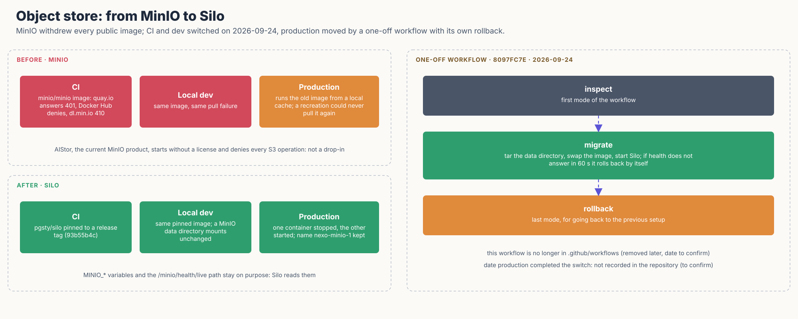

# 2026-09-24: MinIO withdrew its public images

## Summary

CI broke overnight with no change on our side: MinIO archived the open-source repository (in April, per the commit) and then withdrew its public distribution. Every tag of `quay.io/minio/minio` answered 401, Docker Hub denied `minio/minio` and `minio/mc`, and `dl.min.io` returned 410 for the server binary. The object store was replaced by Silo, a maintained AGPL fork, in CI and local development on 2026-09-24 (`93b55b4c`), and production was moved by a one-off workflow the same day.

## Impact

- CI and local development could not start the S3-compatible service; pipelines that needed it failed. Production kept running its already-pulled image from a local cache (commit message: "Production still runs the old image from a local cache"), but could never pull it again, so any recreation of that container would have failed (`8097fc7e`).
- User impact: none recorded.

## Timeline

- 2026-09-19, `474b73cb` and `32dd20f5`: earlier stopgaps, pulling the local MinIO image from quay.io and fixing the CI image on the self-hosted runners (context: pulls were already getting harder).
- 2026-09-24 10:41, `93b55b4c`: CI and dev switch to `pgsty/silo` pinned to a release tag, after verifying every S3 call the app makes and that a MinIO `RELEASE.2025-02-28` data directory mounts unchanged.
- 2026-09-24 12:03 to 12:14, `8097fc7e`, `189b9f8d`, `145a0282`, `11158e2d`: one-off storage migration workflow (modes `inspect`, `migrate`, `rollback`; `migrate` tars the data directory, swaps the image and rolls back by itself if health does not answer in 60 s), purge of leftover MinIO images, naming cleanup. The status probe stopped calling the store "AWS S3" (`98df9245`, 2026-09-23).
- 2026-09-24 16:22, `c41a5887`: production infra compose versioned (container names kept), RabbitMQ dropped.
- 2026-09-26, `697da691`: workflows with no job left are retired; the one-off migration workflow is not among the files in `.github/workflows/` today, so it was removed at some point (TODO: confirm when).
- Date production completed the switch: not recorded in the repository (TODO: confirm). The status page copy was already updated on 2026-09-24.

*The object store before and after the move to Silo, and the steps of the one-off workflow.*

## Root cause

An unpinned external dependency whose publisher removed it. The project depended on `minio/minio` images being pullable; none was left, and MinIO's current product (AIStor) starts without a license and then denies every S3 operation, so it was not a drop-in.

## Detection

CI failures overnight (commit message). Not a monitored event: nothing watched upstream availability.

## Resolution

- Silo, pinned to a release tag, never `latest`. Same on-disk format, so production moved by stopping one container and starting the other, with a backup and someone watching.
- `MINIO_*` variable names and the `/minio/health/live` path stay on purpose: Silo reads them. The container is still called `nexo-minio-1` because the nightly backup depends on it.

## Guards added

- Image pinned by tag; the migration workflow is itself the audit trail of what was stopped and started.
- The status probe tests usability (S3 `ListBuckets` with our credentials), not the server's health endpoint ([status-page](../architecture/status-page.md)).
- [ADR 0007](../adr/0007-silo-storage.md) records the decision and the alternatives.

## Lessons

- Pin images, and keep a way to rebuild from what you can still pull. Production surviving on a local cache is a warning sign.
- Verify a replacement against the exact thing it replaces before moving production.
- Container names can be load-bearing for things outside the repo.

## Related files

- `.github/workflows/ci.yml`, `infra/dev.yml`, `infra/prod.yml`, `src/lib/storage/s3.ts`
- [../adr/0007-silo-storage.md](../adr/0007-silo-storage.md), [../architecture/infrastructure.md](../architecture/infrastructure.md)
