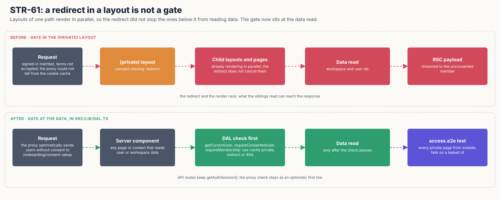

# 2026-10-17: STR-61, workspace ids leaked to unconsented members

## Summary

Access to a workspace was enforced by a redirect in the `(private)` layout. Layouts of one path render in parallel, so the redirect did not stop the layouts and pages below it from rendering. A signed-in member who had not accepted the terms received workspace and user ids in the RSC payload whenever the proxy could not tell from the cookie cache. STR-61 is the issue identifier used in the commits and code. Fixed on 2026-10-17 by moving the gate to the data (`86408ed6`, `bad53505`).

## Impact

- Exposure: workspace and user ids in the RSC payload, to a member who had not consented (`86408ed6`). Not page content or other data as far as the commit says; nothing else in the repository measures what was served.
- Who: members without consent for a workspace they belonged to. The condition "the proxy could not tell from the cookie cache" describes when the proxy's optimistic check did not catch it.
- Duration: at most since the consent redirect was added to the `(private)` layout (`afc53911`, 2026-05-18) until the fix on 2026-10-17. Whether the leaking home layout and the cookie-cache condition existed for that whole span is not recorded.

## Timeline

- 2026-10-16 22:25, `739a529d`: instant-navigation validation made opt-in; the commit already refers to the private app's session gate "which blocks by design (STR-61)".
- 2026-10-17 13:32, `4551dde9`: the proxy routes users without consent from the signed cookie cache to `/onboarding/consent-setup` (optimistic first line).
- 2026-10-17 15:12, `ade2010b`: `app/(private)/__tests__/access.e2e.test.ts` checks each private page from outside as anonymous, stranger and unconsented member (with and without the cookie cache). It also fixed the e2e helper, whose raw `Set-Cookie` folded the session cache into an attribute name, so the proxy's cookie-cache check had never been exercised.
- 2026-10-17 15:12, `86408ed6`: workspace pages, the home layout and the project and wiki contexts call the data access layer, which checks session, consent and membership next to the data.
- 2026-10-17 15:34, `bad53505`: the `(private)` layout gate is removed; the workspace layout renders its frame at once and waits for the viewer inside boundaries.
- Tags that deployed these commits: `2026.10.17` and `.1` to `.5` (inferred from the date; not matched commit by commit).

*Layout redirect before, DAL check at the data read after.*

## Root cause

Treating a layout redirect as a security boundary. In the App Router, redirecting in one layout does not cancel sibling and child layouts that already started rendering, so what they read can reach the response.

## Detection

Not stated in the commits; the fix and its test arrived within hours of each other. **(Operator-provided)** the issue was tracked as STR-61 in the project tracker; how it was found is not recorded in this repository.

## Resolution

Rendering reads go through `src/lib/dal.ts` (`getCurrentUser`, `requireConsentedUser`, `requireMembership`): `use cache: private`, redirect or 404 on their own, called by every server component that reads user or workspace data. `proxy.ts` keeps an optimistic cookie-cache check in front; API routes keep `getAuthSession()`. Details in [ADR 0003](../adr/0003-dal-instead-of-layout-gates.md) and [auth](../architecture/auth.md).

## Guards added

- `access.e2e.test.ts` asserts a redirect or 404, as status or streamed into the document, and fails on a leaked id. New private pages must be added to it.
- `requireConsentedUser` is marked `SECURITY GATE (STR-61) - do not remove or weaken`.
- The access check lives next to the data, so a page cannot render data without passing it.
- Audit: `audit.access.consent.gate.blocked` records refusals ([observability](../operations/observability.md)).

## Lessons

- Put the gate where the data is read, not where the page is framed.
- Test private pages from outside, as the people who must not see them.
- A test helper that does not send the real cookies tests a different system.

## Related files

- `src/lib/dal.ts`, `proxy.ts`, `src/lib/auth-cookie.ts`, `src/lib/consent.ts`
- `app/(private)/__tests__/access.e2e.test.ts`
- `docs/adr/0003-dal-instead-of-layout-gates.md`, `docs/diagrams/private-access.svg`
