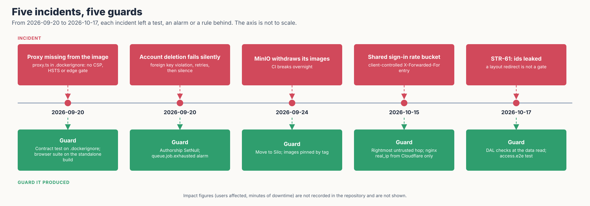

# Postmortems

## Purpose

Blameless records of real incidents, reconstructed from git history and code comments. Each page says what happened, why, how it was found, what fixed it and which guard now exists. They exist so the same class of failure is recognised early, and so that tests and rules cited in other docs have their origin written down.

Everything here is verifiable from commit messages (cited by hash and date) or code comments. Facts that came from the project owner rather than the repository are marked **(operator-provided)**, and gaps are marked `TODO: confirm` or "inferred". Impact figures (users affected, minutes of downtime) are not in the repository and are not invented.

## Index

| Date | Page | One line |
| --- | --- | --- |
| 2026-09-20 | [csp-and-missing-proxy](./2026-09-20-csp-and-missing-proxy.md) | `proxy.ts` was excluded from the image, so no CSP, no HSTS and no edge auth gate; restoring it exposed a CSP that blocked hydration |
| 2026-09-20 | [delete-account-foreign-key](./2026-09-20-delete-account-foreign-key.md) | Account deletion failed on a foreign key for the feature's whole life, silently; alarm added 2026-09-21 |
| 2026-09-24 | [minio-image-withdrawn](./2026-09-24-minio-image-withdrawn.md) | MinIO withdrew its public images; CI broke overnight; moved to Silo |
| 2026-10-15 | [better-auth-shared-bucket](./2026-10-15-better-auth-shared-bucket.md) | Better Auth read a client-controlled `X-Forwarded-For` entry and shared one sign-in rate bucket |
| 2026-10-17 | [str-61-consent-leak](./2026-10-17-str-61-consent-leak.md) | A layout redirect did not stop child layouts from rendering; unconsented members got workspace ids in the RSC payload |

## Template

Title, Summary, Impact, Timeline (dates from commits), Root cause, Detection, Resolution, Guards added, Lessons, Related files. Add a new page per incident, named `YYYY-MM-DD-slug.md`, dated by the day of the fix commit unless the incident date is known. Do not rewrite an old postmortem; append a follow-up section.

## Common threads

- **A failure that is quiet looks like success.** Two of five incidents (missing proxy, silent deletion job) ran in production for a long time because nothing complained. Later guards are loud on purpose: the contract test on `.dockerignore`, the `queue.job.exhausted` alarm.
- **Test the artifact, not the idea of it.** The standalone browser suite ([ADR 0006](../adr/0006-standalone-output-and-browser-tests.md)) exists because the CSP defect only appears in a real browser against the real build.
- **Dependencies you do not control disappear** (MinIO) and **headers you do not control lie** (`X-Forwarded-For`).

*The five incidents from 2026-09-20 to 2026-10-17 and the guard each produced.*

## Related files

- [../adr/README.md](../adr/README.md), [../operations/runbooks.md](../operations/runbooks.md)
